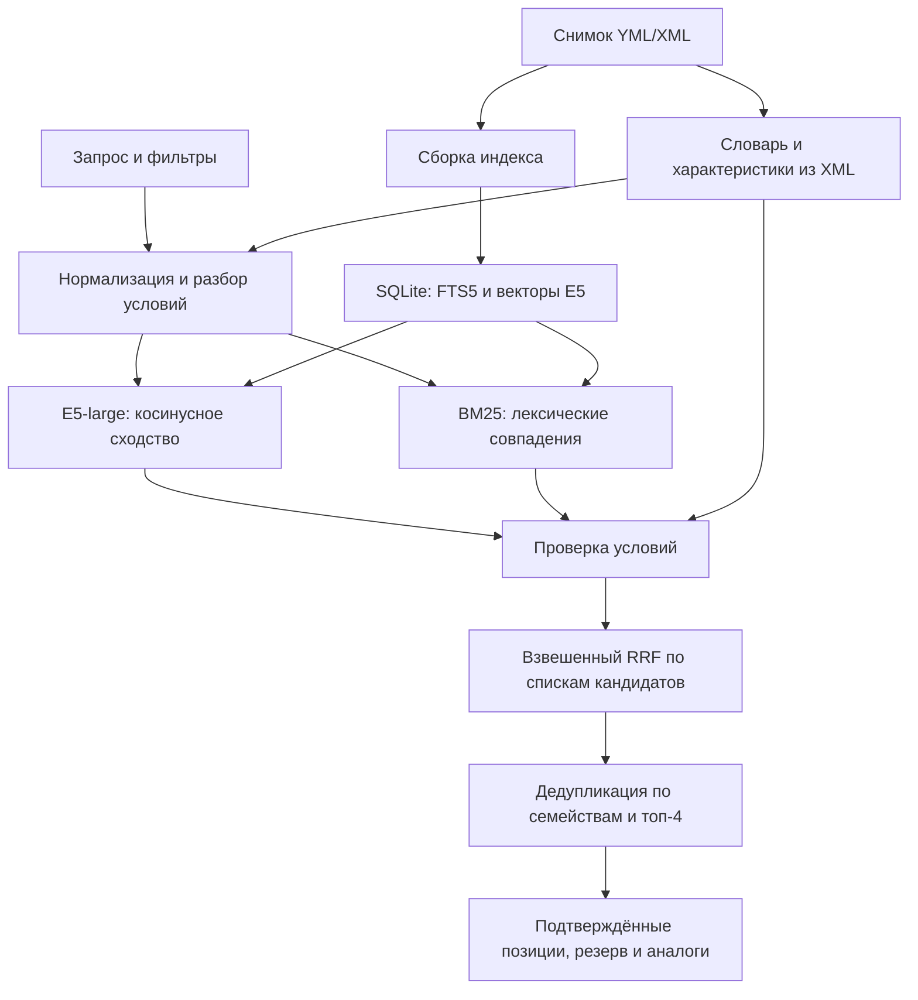
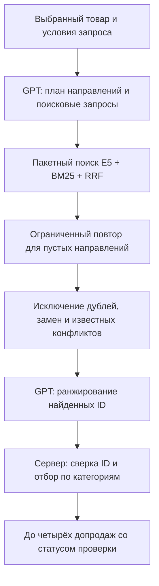

# Умный поиск по каталогу Softline

Проект для хакатона ИИкузница. Поиск разбирает запросы на русском языке, подбирает до четырёх продуктовых семейств из каталога Softline и показывает цену и ссылку на предложение. На карточке можно запросить похожие товары и допродажи.

**[Открыть публичное демо](http://93.88.206.85/)**

## Бизнес-задача

Покупатель может описать нужный товар разговорными словами, указать точный артикул или задать ограничения по цене и характеристикам. Система помогает найти подходящие предложения и подобрать дополнение к выбранному товару. При недостатке характеристик интерфейс отмечает условия, требующие сверки. [Постановка задачи ИИкузницы](<ИИкузница_—_Умный поиск на сайте.pdf>)

## Основные возможности

- Поиск по смыслу, названию, артикулу и характеристикам. Нормализация распространённого жаргона, опечаток и неверной раскладки по словарю каталога.
- Условия по типу товара, производителю, бюджету и поддерживаемым характеристикам. Для ПО учитываются платформа, срок подписки и число рабочих мест.
- До четырёх различных семейств с указанием неподтверждённых условий у резервных позиций. При точном артикуле могут дополнительно показываться отдельно помеченные аналоги.
- Подсказки от двух символов, фильтры и сравнение похожих товаров по доступным характеристикам.
- Подбор допродаж по кнопке «Подходит к этому товару». Карточка показывает основание рекомендации и статус проверки совместимости.

## Архитектура поиска



E5-large кодирует запрос с префиксом `query:`, а текст карточки с `passage:`. Модель даёт семантические совпадения для русских запросов и англоязычных названий. BM25 дополняет их точными совпадениями. Веса названия, артикула и остального текста в FTS5 составляют 2, 4 и 1.

RRF объединяет позиции кандидатов в двух ветках через `0.7/(60 + rank_e5) + 0.3/(60 + rank_bm25)`. Отсутствие кандидата в ветке даёт нулевой вклад. Начальная глубина объединения составляет 100 позиций на ветку и расширяется при нехватке семейств. Объединение по рангам позволяет не калибровать между собой косинусные оценки и BM25.

Подтверждённые конфликты исключаются. Для резерва должны совпасть признаки идентичности товара, а неподтверждённые условия перечисляются на карточке. Основной ключ семейства — `group_id`. Для части предложений без группы используется сочетание производителя, категории и артикула.

Индекс хранит заранее рассчитанные векторы товаров. При поиске хранящиеся в SQLite векторы загружаются в NumPy, а модель кодирует только запрос. Основной поиск обходится без вызова GPT.

## Агент допродаж и совместимость

Docker-ветка использует Plan-and-Execute V3.2. Первый вызов GPT планирует до шести направлений и формулирует отдельный запрос для каждого. Сервер выполняет пакетный гибридный поиск по каталогу. Для части пустых направлений выполняется повторный поиск по альтернативной формулировке. Второй вызов ранжирует реальные ID, после чего сервер отбирает позиции из разных категорий. Допускается дополнительный вызов для исправления формата ранжирования.



V3.2 исключает известные конфликты, например несовпадение типа памяти. Оставшиеся рекомендации помечаются как `UNKNOWN` и требуют сверки. Цена, артикул и URL берутся из каталога. При отключённом LLM, отсутствии ключа или сбое провайдера этот режим возвращает причину вместо списка.

В ветке с V3.3 агент дополнительно передаёт GPT очищенные характеристики, а сервер применяет общий валидатор до ранжирования и после него. `CONFIRMED` означает, что правила подтвердили совместимость, `UNKNOWN` — что данных недостаточно, `REJECTED` исключается из выдачи. V3.3 включена по умолчанию в своей ветке и имеет отдельные ограничения, описанные в приложении. [Сравнение версий и результаты ревью](docs/experiments.md#эксперименты-с-допродажами)

Локальные правила покрывают, в частности, артикулы сменных батарей APC, габариты ноутбуков и отделений сумок, платформу и покрытие рабочих мест для лицензий. Сценарий подбора батареи доступен из CLI без LLM. [Справочник характеристик](softline_search/compatibility_specs.json)

Интерфейс использует `GET /api/search`, `GET /api/recommend`, `GET /api/similar` и `GET /api/suggest`. В локальном демо `debug=1` на `/api/recommend` добавляет план, результаты поиска и причины отсева.

## Технологический стек

- Python 3.13, NumPy, PyTorch и Transformers. Мультиязычная модель `intfloat/multilingual-e5-large` закреплена на конкретной ревизии. [Настройки модели](softline_search/encoder.py)
- SQLite FTS5 и локальные эмбеддинги на 1 024 компоненты. SQLite также используется для кеша проверенных характеристик.
- OpenAI Responses API через совместимого провайдера. В шаблоне настроен ProxyAPI и модель `gpt-6-luna`. Поиск, подсказки и похожие товары выполняются локально.
- Веб-интерфейс на HTML, CSS и JavaScript, HTTP-сервер Python. В Docker-ветке Nginx проксирует запросы и ограничивает частоту обращений.

## Данные и качество

Снимок Softline от 25 ноября 2026 года содержит 136 040 предложений и 9 311 записей категорий. Поисковый индекс включает 44 601 предложение с `available="true"`. Нулевая или отсутствующая цена отображается как «цена не указана». Для запуска требуется отдельный XML-снимок.

Основной тест включает 130 запросов и 542 размеченных предложения, сведённых к 393 парам «запрос — семейство». Все 130 запросов сопоставлены с эталонами в семейной оценке. Метрики учитывают подтверждённые позиции. [Размеченная выборка](outputs/softline-combined/test_queries_combined.xlsx)

| Метод | HitRate@1 | HitRate@4 | MRR@4 | Recall@4 | nDCG@4 |
| --- | ---: | ---: | ---: | ---: | ---: |
| **E5-large + BM25** | 59,2% | **98/130 (75,4%)** | 0,663 | **55,3%** | **0,573** |
| E5-large | 60,0% | 98/130 (75,4%) | 0,663 | 54,3% | 0,568 |
| BM25 | 47,7% | 82/130 (63,1%) | 0,535 | 46,8% | 0,480 |

HitRate показывает долю запросов с хотя бы одним эталоном, MRR — средний обратный ранг первого эталона, Recall — среднюю долю найденных эталонов. nDCG учитывает позиции всех совпадений.

На диагностическом семейном бейзлайне до нормализации и проверки условий гибрид находил эталон в топ-4 у 80/130 запросов (61,5%). Итоговый замер даёт на 18 попаданий больше. Текущие E5 и гибрид равны по HitRate@4. Гибрид увеличивает Recall@4 на 1,0 п. п. относительно E5, при этом E5 чаще находит эталон на первом месте.

Четыре подтверждённых семейства получены для 92/130 запросов. В сохранённом прогоне гибрид занял 128/420 мс по p50/p95. Повтор на текущем коде воспроизвёл метрики качества из таблицы. [Результаты по запросам](outputs/softline-fix/search-evaluation.json)

В сравнительном прогоне допродаж V3.2 вернула хотя бы одну позицию в 8/10 запусков против 9/10 у V3.1. Медиана задержки составила 4,68 с против 8,85 с, число LLM-вызовов — 19 против 47. Все показанные позиции V3.2 получили `UNKNOWN`. Разметки релевантности в этом прогоне нет. [Журнал сравнения](outputs/softline-v3/comparison-v32.json)

Экспериментальная V3.3 вернула позиции для 7/9 товаров, как и V3.2 на том же наборе. Во всех показанных парах совместимость осталась неподтверждённой. [Телеметрия обеих версий](docs/experiments.md#v33-против-v32)

## Экономика эксплуатации

У локального поиска 0 ₽ внешних расходов на модели за запрос. Индексация каталога и поиск потребляют ресурсы сервера. Аренда, электроэнергия и пересборка индекса в этой оценке отдельно не измерялись.

В калькуляторе ИИкузницы по 10 запросам допродаж от 28 ноября 2026 года расчёт по GPT-6 Luna составил **0,0844 ₽ за подбор без НДС**. Это оценка двух вызовов по среднему числу токенов и историческому тарифу. Фактическая стоимость зависит от тарифа, повторных вызовов и доли попаданий в кеш. [Исходные допущения](docs/experiments.md#экономика)

При 500 поисках в сутки получится около 15 000 поисков за 30 дней. При доле кликов по допродажам 25% и той же средней цене токенов внешние расходы на них составят около 317 ₽ за месяц. Инфраструктура учитывается отдельно.

## Примеры

| Запрос или действие | Ожидаемый результат на проверенном снимке |
| --- | --- |
| `ноутбук асус до полтинника` | Разбор выделяет ноутбук ASUS и цену до 50 000 ₽. При отсутствии подходящих позиций выдача может быть пустой. |
| `EP2-06605` | Microsoft Office 2024 на один ПК. MobiOffice выделен как аналог из смежной категории. |
| `7MD68A` → «Подходит к этому товару» | Карточка HP LaserJet M111w. Подбор зависит от доступности провайдера и найденных кандидатов. |
| `recommend 82106` в CLI | Для ИБП APC SRT2200RMXLI-NC правила подтверждают батарею APCRBC141 по артикулу. |

## Запуск

### Локальное демо

Выполняйте команды из корня проекта в PowerShell с Python 3.13. Поместите полученный снимок каталога в `Mindbox.yml.gz.xml`. Это распакованный XML. Каталог и готовый индекс исключены из Git. Если готового индекса для этого снимка нет, соберите его. При первом обращении к E5 скачиваются веса модели.

```powershell
py -3.13 -m venv .venv
.\.venv\Scripts\python.exe -m pip install -r requirements.txt
.\.venv\Scripts\python.exe -m softline_search build-index --catalog Mindbox.yml.gz.xml
.\.venv\Scripts\python.exe -m softline_search demo --recommendation-agent v3.2
```

Откройте [локальное демо](http://127.0.0.1:8765/). `--catalog` и `--index` задают альтернативные пути. `--device auto` выбирает CUDA при её доступности, иначе CPU. Пересобирайте индекс после замены XML.

Чтобы включить допродажи с GPT, выполните `Copy-Item .env.example .env` при отсутствии `.env`, затем задайте `OPENAI_API_KEY`. Проверьте `LLM_ENABLED=true`, `LLM_PROVIDER=openai`, `OPENAI_BASE_URL` и `LLM_MODEL`. Ожидание подбора, лимит выходных токенов, параллелизм и TTL результата задаются через `AGENT_TIMEOUT_SECONDS`, `AGENT_MAX_OUTPUT_TOKENS`, `AGENT_MAX_CONCURRENT_RUNS` и `AGENT_RESULT_CACHE_TTL_SECONDS`. Поиск доступен без ключа. [Шаблон окружения](.env.example)

```powershell
.\.venv\Scripts\python.exe -m softline_search parse-query "ноутбук асус до полтинника"
.\.venv\Scripts\python.exe -m softline_search search "EP2-06605"
.\.venv\Scripts\python.exe -m softline_search recommend 82106
.\.venv\Scripts\python.exe -m softline_search evaluate --queries "outputs/softline-combined/test_queries_combined.xlsx"
```

### Docker на Linux

Docker Compose и Nginx находятся в опубликованной ветке `feature/deployment`. Приложение запускает V3.2 и E5-large на CPU, использует готовые XML и индекс и прогревает поиск перед открытием HTTP-порта. Nginx публикует порт 80. [Подготовка снимка и запуск Docker](docs/deployment.md)

## Ограничения и развитие

- Индекс покрывает доступные предложения снимка. Поиск зависит от полноты XML, а актуальность цены и наличия — от даты обновления данных.
- Открытые направления допродаж часто имеют `UNKNOWN`. Для сравнения V3.2 и V3.3 есть один прогон на девяти товарах без независимой оценки релевантности. Ревью V3.3 выявило сбой сериализации некоторых фактов и потерю направлений при лимите контекста.
- Публичный стенд работает по HTTP. При превышении лимитов Nginx возвращает HTTP 429. Готовность поиска и доступность LLM проверяются отдельно.
- Следующие шаги — расширение набора проверяемых характеристик и правил, исправление известных дефектов V3.3 и оценка на размеченных парах товаров.

[Методика, эксперименты и отчёты](docs/experiments.md)
