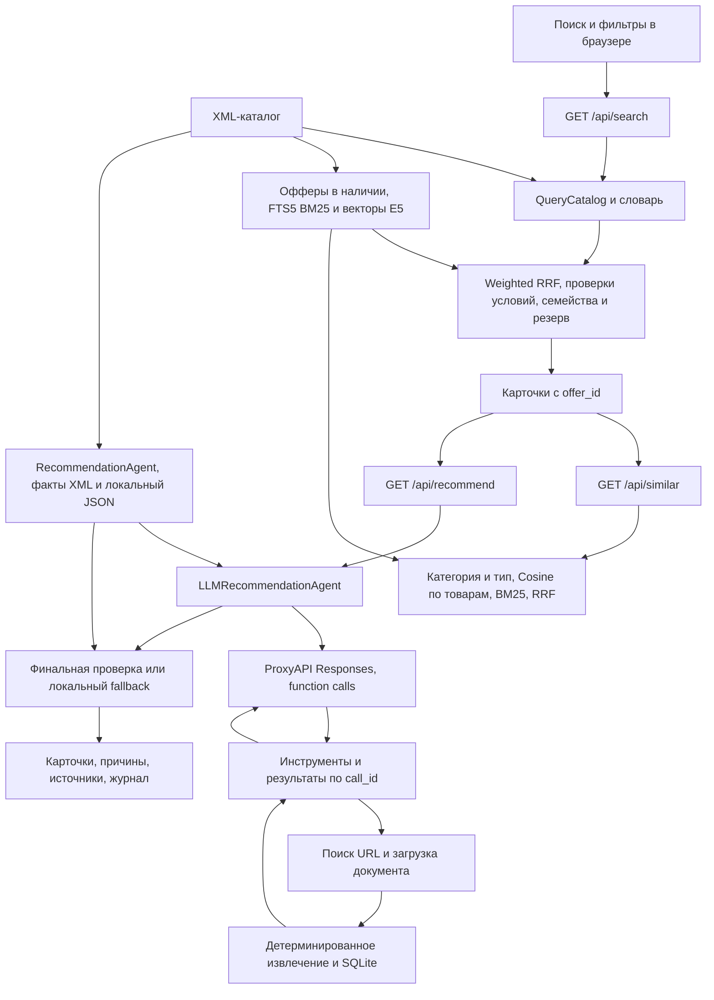

# Softline AI Search — техническое ревью

27 ноября 2026 года · рабочее дерево поверх `109a7d9` · каталог `Mindbox.yml.gz.xml`

## 1. Executive Summary

**Основной поиск можно показать. Сквозную демонстрацию с обещанием стабильного онлайн-обогащения и коммерчески релевантных допродаж пока считаю неготовой.** На 130 запросах гибрид воспроизвёл метрики сохранённого P0. Четыре подтверждённых семейства есть в 92 из 130 выдач. У дословного запроса с `EP2-06605` ожидаемо одно совпадение. Сценарий похожих товаров с этим запросом даёт пустой результат даже при наличии других офисных пакетов в индексе.

| Приоритет | Что подтверждено | Что сделать к 28 ноября |
|---|---|---|
| P0 | Для Zenbook и VivoBook поле модели пустое. Агент отправляет в поиск только артикул и техническое имя поля. Даже при прямой передаче доступных страниц ASUS текущий экстрактор пропускает таблицы. | Подготовить проверенные записи `SKU → модель/вариант корпуса → размеры` для ограниченной и явно описанной части каталога. Использовать существующий слой фактов. Добавить тест на реальной разметке ASUS. |
| P0 | В обоих пустых ответах LLM завершилась успешно с `{"selections":[]}`. Сервер назвал их fallback и показал пользователю общую фразу про локальные данные. Успешный локальный подбор Office занимает миллисекунды. | Сначала запускать полный проверенный локальный подбор. Развести пустой результат, недостающие данные и технический отказ. Сохранять уже подтверждённые предложения и измерять стадии отдельно. |
| P0 для демонстрации Office | 357 SKU формально проходят проверку при общем `Windows`. После группировки остаются два семейства PRO32. Для одного ПК выдаётся пакет на 36 узлов за 68 400 ₽, хотя в фиде есть Office Security Base на одно устройство. | Подтвердить условия покупки точного компактного SKU, учитывать покупателя и показать одну обоснованную рекомендацию при слабой второй. Маркировать подтверждённую версию Windows и полную стоимость. |
| P1 | Три кандидата — инструкция LLM. Полный локальный проход по 30 сумкам без новых фактов не добавляет подтверждений. ExpertBook с уже известными размерами получает две совместимые позиции локально и одну от GPT. | Добавить подтверждённые размеры отделений и отдавать детерминированный shortlist совместимых товаров. Поднимать глубину по измеренному дефициту кандидатов. |

**Экономика наблюдения.** На четырёх одинаковых кликах локальная система дала 4 позиции в 2 ответах. С независимо сверенными размерами в диагностическом сценарии — 7 позиций в 4 ответах. Живой GPT дал 2 позиции в 2 ответах и не записал ни одного нового факта из веб-поиска. Один из повторов VivoBook занял 20,4 с. Эта выборка выявляет механизм потерь, её объёма недостаточно для общего сравнения моделей.

Границы данных. Ревью проведено на текущем рабочем дереве, включая незакоммиченные файлы P1. XML содержит 136 040 офферов, его SHA-256 `27eaec9e77942c61d58b3c04dcaa8991c707dc0fcb64a6442a7408d9908cb148`. Рабочая SQLite содержит 44 601 оффер, SHA-256 `6fadea3efbfe9e2a10d0fd56f82227a69923bdc2e1210e321cfc93808b7eb4c1`. Скриншоты — исторические наблюдения. Они не содержат URL найденных документов, аргументы вызовов, итоговый JSON модели или причину fallback. Ниже эти поля приведены для нового прогона. Основной код и рабочий кеш сохранены. Диагностические прогоны использовали временные файлы и отдельные SQLite.

## 2. Фактическая архитектура



| Компонент и вход | Выход и потребитель | Ограничение и потеря кандидатов |
|---|---|---|
| `catalog.read_catalog`, `index.build_index` и `E5Encoder` читают XML, составляют текст из полей карточки и кодируют multilingual-E5-large фиксированной ревизии. | SQLite `offers`, FTS5 и векторы. `SearchIndex` читает их для `/api/search`, `/api/similar` и `search_catalog`. | Индекс только `available=true`. Резерв поиска означает неизвестное условие среди индексированных товаров. Проверяются схема и ревизия модели, связка хеша SQLite с текущим XML отсутствует. [catalog.py:122](softline_search/catalog.py#L122), [index.py:147](softline_search/index.py#L147), [index.py:298](softline_search/index.py#L298), [encoder.py:4](softline_search/encoder.py#L4) |
| `QueryNormalizer` и `QueryParser` читают запрос, словарь каталога и типизированные значения. | `ParsedQuery` с нормализованным текстом, изменениями, обязательными условиями и предпочтениями. Потребители — поиск, похожие товары и подсистемы допродаж. | Модель, бренд и артикул могут стать жёсткими. Неизвестное значение UI-фильтра отбрасывает оффер. Бренд Asus в допродажи сумок не переносится. [query_normalization.py:94](softline_search/query_normalization.py#L94), [query.py:193](softline_search/query.py#L193), [index.py:610](softline_search/index.py#L610) |
| `_semantic_rank` делает dot product нормированных векторов с E5-запросом, `_lexical_rank` — FTS5 BM25 с весами полей `2/4/1`. | Списки рангов → `_fuse_ranks` с `k=60` → `search_checked` → прямые результаты и отдельно резерв. | Предпочтения переупорядочивают уже ограниченную выдачу. При точном SKU несовпадающие товары отсечены. Путь гибрида по умолчанию проверяет объединение всех семантических рангов и BM25, а в raw CLI действуют другие параметры оценки. [index.py:202](softline_search/index.py#L202), [index.py:340](softline_search/index.py#L340), [index.py:581](softline_search/index.py#L581), [index.py:694](softline_search/index.py#L694) |
| `SearchIndex.similar` берёт исходный товар, запрос и фильтры. | Cosine между векторами товаров + BM25 названия, категории и признаков → RRF → до четырёх SKU и различия. | Строгая категория, равенство множества типов, пересечение назначений, роль офисного продукта и весь набор обязательных ограничений. Есть исключение семейства и модельного варианта. Очень узкий scope лишает ветку альтернатив. [index.py:510](softline_search/index.py#L510) |
| `RecommendationAgent.__init__` отдельно читает весь XML, `compatibility_specs.json` и категории. | Все офферы, семейства, карты APC-артикулов, сумок, размеров и лицензий. Потребители — инструменты, валидатор, fallback. | Допродажи реализованы для APC → батарея, ноутбук → сумка/рюкзак, применимый Office → корпоративный endpoint. Других направлений в runtime нет. `antivirus_business` ограничен таксономией и правилами пригодности. [recommendation.py:25](softline_search/recommendation.py#L25), [recommendation.py:160](softline_search/recommendation.py#L160), [recommendation.py:263](softline_search/recommendation.py#L263) |
| `scenario_candidates` принимает якорь, один разрешённый сценарий, `limit`, категорию и факты. | Локально подтверждённые офферы впереди, затем отсортированные кандидаты. `search_catalog` даёт альтернативный E5/BM25-маршрут. | Дедупликация семейства до передачи остатков модели. Цену и наличие здесь предпочитают, а жёсткий затык для Office возникает при подготовке `_ranked_endpoints`. Факты кеша по непоказанным кандидатам заранее не собраны. [recommendation.py:431](softline_search/recommendation.py#L431), [llm_agent.py:518](softline_search/llm_agent.py#L518) |
| `LLMRecommendationAgent` получает выбранный `offer_id`, `ParsedQuery`, фильтры, правила и сервис фактов. | `_Run.loop` добавляет сообщения инструментов по `call_id`, принимает структурированные пары, повторно проверяет. API возвращает режимы `llm_agent`, `cached_result`, `rule_based_fallback`. | Маршрутизация фактически однонаправленная. Валидация защищает от обхода по неправильно предложенному SKU, но модель может выбросить подтверждённый SKU из своего финала. [llm_agent.py:275](softline_search/llm_agent.py#L275), [llm_agent.py:627](softline_search/llm_agent.py#L627) |
| `OpenAIProvider`, `VendorEvidenceService` получают компактный товарный контекст либо запрос по атрибуту. | Responses API возвращает tool calls, текст и usage. Hosted search возвращает URL, Python скачивает документы, проверяет товар и извлекает факты. | Неподдерживаемая форма документа теряется. URL и результат каждой загрузки не протоколируются. Факты хранятся 30 суток, пары результата — 120 с в памяти. [llm_provider.py:158](softline_search/llm_provider.py#L158), [vendor_evidence.py:415](softline_search/vendor_evidence.py#L415), [vendor_evidence.py:500](softline_search/vendor_evidence.py#L500) |
| Правила читают подтверждённые характеристики, цену, данные XML и контекст. | `CONFIRMED`, `UNKNOWN`, `REJECTED` с причиной. `_select` сортирует, предпочитает доступные позиции с ценой и дедуплицирует. | Сумкам нужны размеры или явный список моделей. Техническое подтверждение лицензии не означает соответствия покупателю. При отсутствии доступных/оценённых совместимых кандидатов возможен локальный резерв. [recommendation.py:460](softline_search/recommendation.py#L460), [recommendation.py:676](softline_search/recommendation.py#L676), [recommendation.py:765](softline_search/recommendation.py#L765) |
| `demo.serve_demo` и `demo_web/app.js` принимают `q`, фильтры, `offer_id`. | HTTP JSON, отдельные действия «Похожие товары» и «Подходит к этому товару», источники и журнал. | Состояние формы может разойтись с запросом, по которому отрисованы карточки. `AbortController` защищает интерфейс от позднего ответа, а backend продолжает обработку. [demo.py:189](softline_search/demo.py#L189), [demo_web/app.js:428](softline_search/demo_web/app.js#L428) |
| `unittest`, `softline_search evaluate`, `evaluate_recommendations.py`, `evaluate_post_p0.py`. | Тесты фикстур, сравнение поиска и локальных правил, ограниченные live-оценки. | Фикстуры используют часть тех же курируемых фактов. Сохранённые live-прогоны охватывают другие клики и не заменяют текущую проверку точных SKU. [evaluation.py:123](softline_search/evaluation.py#L123), [evaluate_post_p0.py](evaluate_post_p0.py) |

### Статус существующих P0 и P1

Отдельного версионированного списка критериев приёмки для этих меток в коде нет. Ниже — проверка заявленных этапов по реализации и экспериментам.

| Этап | Работает | Частично или отсутствует |
|---|---|---|
| P0 · основной поиск и условия | E5/BM25/RRF, нормализация, обязательные условия, фильтры, явный резерв, 130 сопоставленных запросов. | Только 70,77% выдач с четырьмя подтверждёнными семействами. Переносимость первого запуска зависит от артефактов и модели. |
| P0 · детерминированные допродажи | Три сценария, статусы и причины, цена, наличие, базовая полнота лицензии и исключение продлений. | Покрытие 32,2% на широкой локальной выборке. Покупатель не моделируется, сведения по версиям ОС и малым пакетам теряются. |
| P1 · LLM, документы, кеш | Реальные function calls с обратной связью, финальная проверка, hosted search, положительные факты SQLite, быстрый повтор успешного клика. | ASUS и общие PDF не поддержаны достаточно хорошо, автоматического повторного поиска по корпусу нет. Нет смысловых статусов проверок в журнале и возможности расследовать исторические источники. |
| P1 · похожие и подсказки | Рабочие отдельные API, Cosine + BM25 в похожих, подсказки на префиксах каталога. | Точный SKU блокирует альтернативы. Остальные типы проверены выборочно. Подсказки выполнены как бонус, расширение сейчас низкого приоритета. |

## 3. Четыре проблемных примера

Для ноутбуков использован `ноутбук ASUS`, для Office — `Microsoft Office EP2-06605 на 1 ПК под Windows`. Клик привязан к точному `offer_id` из XML, включая Zenbook, который при этом тексте в новом `/api/search` не попал в первые четыре. В актуальном ответе ASUS видны ExpertBook, VivoBook и два ROG. Точный артикул позволяет воспроизвести допродажу независимо от позиции в основном поиске.

### CASE 1 · ASUS Zenbook 14 OLED UX3405CA · `90NB14W1-M01Z50` / `530901`

- В XML указаны ASUS, 153 940 ₽ и 14″. Все три габарита отсутствуют, `product_model=''`, `exact_model=false`. В название XML входит `UX3405CA`, но `_prepare_offer` вычисляет псевдонимы корпуса только для Lenovo и использует `fields.model` для остальных. Поле `<model>` пустое у этого оффера. Посадка подтверждается тремя размерами либо явным совпадением модели. Строгий предел диагонали проверяется отдельно, если он задан и диагональ ноутбука подтверждена вне XML. [recommendation.py:263](softline_search/recommendation.py#L263), [recommendation.py:689](softline_search/recommendation.py#L689)
- Live, холодный кеш: `prepare_context → search_vendor_specs(530901, dimensions_mm) → get_category_products(laptop_bag, '', 3) → check_compatibility ×3 → {"selections":[]} → rule_based_recommendation`. Статус Responses `completed`, итоговая причина `no_confirmed_recommendations`, правила: `UNKNOWN/missing_laptop_dimensions`, 0 офферов.
- Фактический вход hosted search `ASUS 90NB14W1-M01Z50  dimensions_mm`. В ответе `web_search_call.action.query`: `site:asus.com 90NB14W1-M01Z50 dimensions`. Статус документа `no_verifiable_fact`, записей в SQLite нет.

| URL из нового холодного поиска | Результат обработки |
|---|---|
| [ASUS NUC 14 Essential](https://dlcdnwebimgs.asus.com/files/media/53b7cdd6-e9d1-4779-a6cd-ec5d0d775303/asus-nuc-14-essential-datasheet.pdf) | PDF скачан, 347 080 Б. Чужой продукт, PDF-путь для ASUS dimensions отсутствует. |
| [Commercial Product Guide 21](https://dlcdnwebimgs.asus.com/files/media/f506dd94-fd58-4ba1-8d5e-41cca96f5bb9/product-guide/Commercial-Product-Guide-21.pdf) | Загрузка в новом прогоне завершилась `ValueError`, код штатный журнал не сохраняет. Оснований считать документ паспортом Zenbook нет. |
| [ASUS PE100A](https://dlcdnwebimgs.asus.com/files/media/38af93c3-146f-4a7c-ac1d-4e947529263/pe100a-datasheet.pdf) | PDF скачан, 365 076 Б. Чужой продукт, факт отсутствует. |
| [ROG Product Guide](https://dlcdnwebimgs.asus.com/files/media/f506dd94-fd58-4ba1-8d5e-41cca96f5bb9/product-guide/ROG-Product-Guide.pdf) | Загрузка завершилась `ValueError`. Точное соответствие Zenbook не установлено. |
| [NUC 14 Essential с UTM](https://dlcdnwebimgs.asus.com/files/media/53b7cdd6-e9d1-4779-a6cd-ec5d0d775303/asus-nuc-14-essential-datasheet.pdf?utm_source=openai) | После канонизации это первый URL, повторная загрузка не выполнялась. Историческая пятёрка могла отличаться. |

Официальная таблица для корпуса `UX3405CA` найдена отдельно. ASUS показывает `31.24 × 22.01 × 1.49 ~ 1.49 cm`, то есть **312,4 × 220,1 × 14,9 мм**, и выделяет `UX3405CA` отдельной моделью рядом с `UX3405MA`. Региональный официальный Product Guide содержит строку `UX3405CA` с округлением до `31.2 × 22.0 × 1.5 cm`. Точный паспорт `90NB14W1-M01Z50` от ASUS не найден. Связь с корпусом подтверждают название в XML и карточка точного `UX3405CA-ST1336` с тем же part number и теми же размерами. Факт относится к корпусу, комплектацию целиком из паспорта переносить нельзя. Python-загрузчик получил глобальную таблицу, но в сыром документе `_SpecsHTML` не увидел распознаваемой строки размеров. [ASUS Tech Specs](https://www.asus.com/us/laptops/for-home/zenbook/asus-zenbook-14-ux3405/techspec/), [ASUS Product Guide, стр. 39](https://www.asus.com/me-en/event/productguide/2025/asus-product-guide_202509.pdf), [точный артикул и модель у продавца](https://www.kns.ru/product/noutbuk-asus-zenbook-14-ux3405ca-st1336-90nb14w1-m01z50/characteristics/)

| Кандидат в живом shortlist | До размеров ноутбука | После диагностической подстановки размеров |
|---|---|---|
| HP Everyday 16 Briefcase `A08JWAA` / `498146`, 3 434 ₽ | `UNKNOWN/missing_laptop_dimensions` | `CONFIRMED` · до 380 × 240 × 30 мм. |
| HP Everyday 16 Backpack `A08JXAA` / `498147`, 1 356 ₽ | `UNKNOWN/missing_laptop_dimensions` | `CONFIRMED` · до 400 × 270 × 30 мм. |
| Continent CC-201GA `CON-CC201GA` / `125403` | `UNKNOWN/missing_laptop_dimensions`, отсутствует и предел отделения | `UNKNOWN/missing_bag_dimensions`. В карточке Softline указаны оси отделения 280 × 300 × 35 мм и отдельно внешние 400 × 300 × 50 мм. При опубликованных внутренних размерах Zenbook не проходит длинную ось даже при повороте. У продавцов есть противоречащие данные, в аудите этот SKU не подтверждён. [Карточка Softline](https://store.softline.ru/continent/con-cc201ga-125403/) |

Оба HP проходят без изменения валидатора. Остальные 28 сумок не имеют машинно подтверждённого предела отделения. Для ручного обогащения пригодны, например, Defender `26019`, Digma `N370GBK`, Continent `CC-204 BK`, но их диагонали недостаточно для вывода о совместимости. У Defender для `26019` производитель прямо требует сравнить три размера отделения. [Defender FAQ](https://defender.ru/faq/?item=1613)

Задержка 15 318 мс в новом прогоне. Вызовы модели без поиска 2 328 + 923 + 1 214 + 2 099 мс. Поиск URL 3 845 мс внутри 8 738 мс `search_vendor_specs`. Четыре загрузки заняли суммарно 4 167 мс, два разбора PDF — 719 мс. Категория 0,76 мс, три проверки суммарно 0,76 мс, fallback 1,78 мс. Разбор запроса и сериализация добавили 2,49 и 0,26 мс вне таймера агента. Задержка 13 171 мс на скриншоте согласуется с той же последовательной схемой; её конкретные промежуточные ответы не сохранены.

### CASE 2 · ASUS VivoBook 16 X1605VA-MB2106 · `90NB10N3-M02KZ0` / `496397`

- XML: ASUS, 84 790 ₽, 16″. `product_model=''`, `exact_model=false`, все три габарита неизвестны. Поиск с входом `ASUS 90NB10N3-M02KZ0  dimensions_mm` сформировал `site:asus.com "90NB10N3-M02KZ0" dimensions`. Холодный результат: 0 URL и 0 HTTP-загрузок. Статус `source_unavailable` здесь получен при отсутствии попытки HTTP. Увеличение HTTP-таймаута не меняет этот исход.
- Live: тот же маршрут, что у Zenbook. Три кандидата — `A08JWAA`, `A08JXAA`, `CON-CC201GA`. Все получили `UNKNOWN/missing_laptop_dimensions`. Модель вернула валидный пустой финал, fallback `no_confirmed_recommendations`, 0 рекомендаций. В новом повторе найдено пять URL, затем скачивались материалы по ExpertCenter, NUC и гайд, ни один факт не принят. Это различие между пустым поиском и поиском неправильных документов.
- Прямой поиск по `ASUS X1605VA` даёт официальную региональную страницу. Японский сайт выделяет `X1605VA`, показывает `35.87 × 24.95 × 1.99 ~ 1.99 cm` и в другой колонке `358.7 × 249.5 × 19.9–20.35 mm`. Глобальная страница тоже доступна, но конфигурации и колонки на ней различаются. Точное значение **358,7 × 249,5 × 19,9 мм** для MB2106 подтверждает карточка с точными моделью и part number. У другого продавца ширина 358,6 мм, а у ещё одного заявлена глубина 310 мм. Паспорт точного суффикса у ASUS не найден. Формальная рекомендация требует сохранения проверенной привязки комплектации или консервативной границы толщины из подходящей колонки, с разрешением конфликта глубины. Официальный верхний предел толщины 20,35 мм вывода о двух HP не меняет. [ASUS Japan](https://www.asus.com/jp/laptops/for-home/vivobook/vivobook-16-oled-x1605/techspec/), [ASUS Global](https://www.asus.com/laptops/for-home/vivobook/vivobook-16-oled-x1605/techspec/), [точный SKU, размеры и part number](https://ekaterinburg.technopark.ru/noutbuk-asus-vivobook-16-x1605va-mb2106-90nb10n3-m02kz0-803307/description/), [расхождение глубины у продавца](https://www.mvideo.ru/products/401955907/specification)
- При диагностической подстановке `A08JXAA` проходит три оси. `A08JWAA` получает `REJECTED/incompatible_dimensions`, так как 249,5 > 240 мм. `CON-CC201GA` остаётся `UNKNOWN/missing_bag_dimensions`. Других подтверждённых из 30 сумок не найдено. В коде нет второго запроса по корпусу для ASUS, а повтор с теми же аргументами блокируется внутри прогона. Повторный клик всё же запускает новый поиск, SQLite не содержит отрицательной записи.
- Профиль: 7 624 мс агента в холодном прогоне, 2 880 мс поиска, весь `search_vendor_specs` 2 881 мс, 4 735 мс суммарно на четыре модельных шага, правила 1,50 мс. Повтор занял 20 388 мс, включая 16 024 мс на внешний инструмент и 7 194 мс на одну неуспешную загрузку. Независимая прямая загрузка Japan/Global через проектный клиент удалась примерно за 3,2/4,5 с, `verify_document` не извлёк факт. Надпись «Источник недоступен» на скриншоте сама по себе не свидетельствует о недоступности ASUS.

### CASE 3 · ASUS ExpertBook B1 B1503CVA · `90NX0801-M00EU0` / `538620`

Данные XML — выбранный оффер, названия, цены и наличие. Размеры `359,5 × 232,2 × 19,9 мм` и диагональ 15,6″ берутся из `compatibility_specs.json` по точному артикулу. Там же заранее записаны лимиты обоих HP. SQLite и внешний поиск в живых прогонах этого SKU не использовались. XML округляет диагональ до 16″. Парсер отмечает конфликт и использует 15,6″ из ASUS. [compatibility_specs.json:94](softline_search/compatibility_specs.json#L94)

| Идентификатор и факт | Независимая сверка |
|---|---|
| `B1503CVA` · 359,5 × 232,2 × 19,9 мм | ASUS Global отдельно показывает `B1503CVA`, Core 7 150U и строку `35.95 x 23.22 x 1.99 ~ 1.99 cm`. XML связывает `90NX0801-M00EU0`, `B1503CVA` и 150U. Страница покрывает несколько конфигураций с этими габаритами. Точный номер `90NX0801-M00EU0` в таблице ASUS отсутствует. [ASUS Tech Specs](https://www.asus.com/laptops/for-work/expertbook/asus-expertbook-b1-b1503/techspec/) |
| `A08JXAA` · 400 × 270 × 30 мм | HP указывает это в строке `Recommended max laptop dimension (metric)` для `A08JXAA`. Внешние размеры рюкзака в отдельной строке — 310 × 155 × 440 мм. Три запаса по осям составляют 40,5 × 37,8 × 10,1 мм. [HP A08JXAA](https://www.hp.com/ie-en/products/accessories/product-details/product-specifications/2102293045) |
| `A08JWAA` · 380 × 240 × 30 мм | Другая модель и другой предел отделения, внешние 405 × 60 × 305 мм. Запас 20,5 × 7,8 × 10,1 мм. Диагональ 15,6″ допустима для обеих HP. [HP A08JWAA](https://www.hp.com/ie-en/products/accessories/product-details/product-specifications/2102293041) |

В холодном D модель вызвала категорию и три проверки, получила два `CONFIRMED/dimensions_match` и один `UNKNOWN/missing_bag_dimensions` (Continent). В финале выбрала только `498146` (`A08JWAA`). В C вызвала также два `get_verified_specs` для HP и выбрала `498147` (`A08JXAA`), как на скриншоте. Сервер перепроверил выбранную пару. Никакой квоты на одну рекомендацию здесь нет, второй кандидат пропал в финальной селекции GPT. Локальный результат стабилен и содержит оба SKU. В D 10 928 мс получились из трёх модельных шагов 923 + 1 210 + 8 789 мс, в C — 4 920 мс. Исторические 3 507 мс измеряли другой вызов модели, его ID на скриншоте отсутствует.

Повтор D в том же процессе вернул `cached_result` с тем же `A08JWAA` за 0,35 мс. После перезапуска ответы локальных правил сохранили обе позиции, так как исходные факты находятся в файле. Память выбранных GPT пар сбрасывается, поэтому повторный выбор того же SKU после рестарта не гарантирован.

### CASE 4 · Microsoft Office 2024 для дома и бизнеса · `EP2-06605` / `473582`

Якорь из XML: 36 584 ₽, бессрочный Office, 1 устройство, платформа `windows`. В контексте подтверждаются запрос на 1 ПК и общее Windows. Состав Office не содержит признаков включённого антивируса. Страница Microsoft описывает одноразовую покупку Office с приложениями Word, Excel, PowerPoint, Outlook и OneNote. Матрица поддержки Microsoft указывает Windows 11 для актуальной поддержки. В карточке Store отдельно указаны Windows 11 и 10. Версию ОС покупателя нельзя вывести из артикула или общего слова Windows. [Microsoft Store](https://www.microsoft.com/en-us/microsoft-365/p/office-home-business-2024/cfq7ttc0pbm7), [Microsoft Support](https://support.microsoft.com/en-us/office/system-requirements/office-suites-for-individuals-and-families)

| Оффер локального результата | Технический статус по коду | Коммерческая оценка для 1 ПК |
|---|---|---|
| `398852` · `PRO32-PSA-CLS-1Y-5-NS-RU` · Advanced, 5 узлов, 15 750 ₽ | `CONFIRMED/platform_and_license_match` при общем Windows. `К-во узлов=5`, полная версия, пакет 1 шт., цена не умножается на 5. | Минимальный подтверждённый пакет Advanced в этом снимке. Четыре лишних узла, коммерческий покупатель должен быть допустим. |
| `399141` · `PRO32-PSS-CLS-1Y-36-NS-RU` · Standard, 36 узлов, 68 400 ₽ | `CONFIRMED/platform_and_license_match` при общем Windows. `К-во узлов=36`, покупка 1 пакета. | 35 лишних узлов и на 52 650 ₽ дороже первого. Более компактных прошедших SKU Standard не найдено. Сохранился как лучший представитель второго семейства. |

`Capacity` различает узел/устройство, пользователя и сервер, диапазон, поштучную цену и минимальное количество. Для двух PRO32 нет указания на поштучную цену или заказ нескольких пакетов. Фид даёт полную лицензию и фиксированное число узлов, из чего код выводит цену пакета. Право на новую покупку поддержано фидом и маркировкой `NS`, а договорный минимум и условия заказа у производителя для этих артикулов отдельно не подтверждены. Код по умолчанию ставит минимум 1. Валидация клиента проверяет пригодность корпоративного SKU, но `EndpointContext` не содержит тип покупателя. Техническая ветка для отдельно введённых Windows 10 и 11 возвращает 0 и `UNKNOWN` на той же выборке, потому что XML даёт `Windows` без версии. Группа `Windows Server` конфликтует с контекстом. Страница PRO32 в основном блоке явно упоминает клиентский Windows 11, а в FAQ список для антивируса не везде его повторяет. Для версии и редакции полезна проверка конкретного агента Endpoint, отдельно от консоли управления. [PRO32 Endpoint Security](https://pro32.com/ru/business/pro32-antivirus/endpoint-security/), [recommendation_licenses.py:56](softline_search/recommendation_licenses.py#L56), [recommendation_licenses.py:203](softline_search/recommendation_licenses.py#L203)

В XML у самого Office поле `Пользователь` содержит `не определено`. У компактного `518959` указаны `Юрлицо`, `Полная версия`, `Для офиса`. Эти данные поддерживают сценарий малого бизнеса, но не доказывают пригодность для физлица. Точные страницы Softline двух больших пакетов вернули HTTP 403 при независимой проверке, поэтому вывод об единице цены опирается на фид и его интерпретацию. [Advanced, карточка SKU](https://store.softline.ru/pro32/pro32-psa-ns-1-5-398852/), [Standard, карточка SKU](https://store.softline.ru/pro32/pro32-pss-ns-1-36-399141/)

| Позиции на 1–4 устройства | Что найдено или исключено |
|---|---|
| PRO32 Office Security Base `PRO32-PUS-EKEY-3Y-1-NS-RU-AKS` / `518959`, 1 устройство, 3 790 ₽, 3 года | `REJECTED/not_workstation_protection` по текстовому правилу. Производитель подтверждает защиту рабочих ПК и Windows 10/11 для продукта, карточка Softline связывает точный SKU с одним устройством. Сайт производителя рекламирует наборы от пяти устройств. Для SKU канала Softline остаётся сверить единицу продажи, минимум и доступность новой покупки. Это самый сильный найденный кандидат для проверки перед демо. [PRO32 Office Security Base](https://pro32.com/ru/business/pro32-antivirus/office-security-base/), [точные SKU Softline](https://store.softline.ru/pro32/pro32-office-security-base/) |
| Ещё три Office Security Base | `518958` · 3 устройства/2 года/3 090 ₽, `518960` · 3/3/4 090 ₽, `518961` · 1/5/6 390 ₽. Те же причина и требование проверки коммерческих условий. |
| Dr.Web «Антивирус + Центр Управления» `532804`, 1 ПК, 6 500 ₽ | `not_workstation_protection`. Тот же `LBS-AC-12M-1-A3` у предложения `532803` обозначает Server Security Suite. До подтверждения редакции и SKU нельзя считать рабочей альтернативой. Продления проверялись отдельно. |
| IObit Malware Fighter PRO `482646`, 1 ПК/1 год, 854 ₽ | `not_workstation_protection`. Артикул XML пуст, пригодность для данного типа покупателя по точному предложению не подтверждена. |
| Домашние позиции | Есть Dr.Web Security Space и Katana, Kaspersky Standard/Plus/Premium, PRO32 Total Security, а также мобильные предложения. Категория `3775` целиком получает `wrong_candidate_type`. Например, Dr.Web Katana `LHW-KK-12M-1-A3` из фида на 1 ПК за 690 ₽. Уместность домашней лицензии зависит от фактического покупателя и продукта. Проверены и заведомо неподходящие продления и мобильные версии. |
| Остаток корпоративной категории `650` | 6 966 `not_workstation_protection`, 2 665 `incompatible_license_type`, 862 `conflicting_facts`, 135 `restricted_customer`, 50 `unknown_license_capacity`, 3 `missing_platform`. Причина — первый барьер, у части офферов несколько барьеров. |

Новый cold D: `get_category_products` вернул оба семейства, модель проверила оба через `check_compatibility`, вызвала `compare_products`, выбрала только Advanced и завершилась. В C тот же итог. Скриншот с двумя SKU воспроизведён локальным подбором, а его точную причину перехода на fallback по изображению установить нельзя. Замер нового D — 4 972 мс, из них 4 960 мс провайдер, 6,53 мс категория, 0,89 мс две проверки, 0,45 мс сравнение. Локальный прямой вызов ~6,5 мс. Отдельный HTTP offline с `debug=1` и временным SQLite — 42,7 мс с измерением агента 12,8 мс. Наблюдение 5 210 мс согласуется с предварительной работой GPT, сам локальный подбор в измерениях занимает миллисекунды.

## 4. Обнаруженные ошибки

| ID, уровень | Файл, функция и проблемный участок | Воспроизведение и влияние | Ожидаемое поведение, исправление и тест |
|---|---|---|---|
| 01 · High | [`recommendation.py:263`](softline_search/recommendation.py#L263) `_prepare_offer`, `curated or … fields.model`; [`vendor_evidence.py:634`](softline_search/vendor_evidence.py#L634) `_lookup` | Case 1–2, ASUS-коды корпуса есть только в `name`. `product_model=''`, уходит запрос по редкому SKU. Tool schema не даёт модели сменить стратегию поиска того же атрибута. | Хранить отдельно SKU и проверенный корпус, пробовать запрос по корпусу после нуля релевантных URL. Тест на ASUS без `<model>` и соседнем корпусе, который нельзя сопоставить автоматически. |
| 02 · High | [`vendor_evidence.py:343`](softline_search/vendor_evidence.py#L343) `_html_evidence`, [`:316`](softline_search/vendor_evidence.py#L316) `_extract_label_value`, [`:376`](softline_search/vendor_evidence.py#L376) `_pdf_evidence` | Страницы ASUS скачиваются, парсер не видит нужной строки. Даже в простой строке `_DIM_VALUE` отвергнет `1.49 ~ 1.49 cm`. PDF с габаритами ASUS не обрабатывается. | Разобрать сохранённый снимок официальной таблицы с привязкой столбца к корпусу. Использовать верхний предел подтверждённого диапазона. Тесты на две колонки X1605VA, чужой NUC PDF и конфликт источников. |
| 03 · High | [`llm_agent.py:275`](softline_search/llm_agent.py#L275) `recommend`, [`:660`](softline_search/llm_agent.py#L660) `_Run.loop`, [`demo_web/app.js:455`](softline_search/demo_web/app.js#L455) | Пустой итог `completed` переводится в `no_confirmed_recommendations` и fallback. Для готового Office и ExpertBook GPT выполняется прежде правил. После 429 над уже подтверждённой парой код вызывает полный fallback без отдельного сохранения проверенных пар. | Локальный ранний выход при достаточных фактах. Различать `completed_empty`, нехватку данных и техническую ошибку. Накопить подтверждённые пары и перепроверить их при финале. Тест пустого финала и 429 после `CONFIRMED`. |
| 04 · High | [`recommendation_licenses.py:254`](softline_search/recommendation_licenses.py#L254) `is_new_endpoint_license`, [`:386`](softline_search/recommendation_licenses.py#L386) `endpoint_requirements`, [`recommendation.py:765`](softline_search/recommendation.py#L765) `_select` | `518959` исключён по эвристике названия вопреки подтверждённому назначению линейки. Для 1 ПК остаётся пакет на 36 узлов, контекст покупателя не моделируется. | Принимать доказуемое назначение и условия покупки. Ранжировать по пригодности покупателю, полной стоимости и избыточности. Тест 1/36 ПК, B2C, новый заказ, продление и неизвестный минимум. |
| 05 · Medium | [`llm_agent.py:34`](softline_search/llm_agent.py#L34) `_INSTRUCTIONS`, [`recommendation.py:446`](softline_search/recommendation.py#L446) `scenario_candidates`, [`llm_agent.py:665`](softline_search/llm_agent.py#L665) финальные пары | Инструкция просит 3 SKU, остаток дедуплицируется до проверки. В ExpertBook оба HP подтверждены, GPT отдаёт один. | Подтверждённый список формирует сервер, глубина увеличивается при измеренном дефиците. Тест обоих HP и двух вариантов одной семьи с разными фактами. |
| 06 · Medium | [`vendor_evidence.py:597`](softline_search/vendor_evidence.py#L597) `_lookup`, [`llm_agent.py:363`](softline_search/llm_agent.py#L363) `event`, [`:600`](softline_search/llm_agent.py#L600) `_execute`, [`demo_web/app.js:404`](softline_search/demo_web/app.js#L404) | Ноль URL при нуле загрузок → `source_unavailable`. Исключения HTTP/MIME/размера скрыты. Проверка `UNKNOWN` или `REJECTED` выглядит как `ok,count=1`. В журнале отсутствуют ID и разбиение модельных шагов. | Развести причины загрузки и извлечения, добавить пять счётчиков проверки и таймеры с вложенностью. Тест API для 0 URL, 404 и `UNKNOWN`. |
| 07 · Medium | [`index.py:523`](softline_search/index.py#L523) `similar`, `constraints += … required`, `scope` | Точный артикул блокирует иные SKU. Office даже без запроса остаётся без выдачи при ограничении категорией и ролью. | Разделить идентификатор якоря и обязательные требования к альтернативам. При необходимости добавить отдельно маркированный проход по смежным категориям с той же ролью. Тест exact Office, явного бренда и обязательной ОС. |
| 08 · Medium | [`demo_web/app.js:364`](softline_search/demo_web/app.js#L364) `loadSearch`, [`:449`](softline_search/demo_web/app.js#L449) `loadProductOptions` | Подтверждено запуском функций JS с подменённой сетевой функцией. После редактирования формы без Submit клик передаёт новые параметры для старого `offer_id`. Это влияет на Office и похожие. | Передавать snapshot успешного `/api/search`. UI-тест редактирования формы без Submit и смены карточки во время запроса. |
| 09 · Medium | [`llm_agent.py:306`](softline_search/llm_agent.py#L306) `recommend`, [`:269`](softline_search/llm_agent.py#L269) `_save_pairs`, [`vendor_evidence.py:184`](softline_search/vendor_evidence.py#L184) `fetch_vendor_document` | Пустые клики платят снова. Отмена браузера не прерывает поток. Повтор VivoBook 20,4 с, один timeout загрузки 7,19 с при per-operation timeout ≤5 с. | Объединять одновременные одинаковые запросы, соблюдать абсолютный дедлайн сетевых операций, добавить краткую задержку повтора по причине. Тест двух одновременных кликов и медленного чтения. |
| 10 · Medium | [`recommendation.py:431`](softline_search/recommendation.py#L431) `scenario_candidates`, [`llm_agent.py:426`](softline_search/llm_agent.py#L426) `_details` | Начальный shortlist учитывает только уже собранные в `_Run` факты. Прогретые характеристики непоказанного аксессуара могут остаться за лимитом. Индекс `_ranked_bags` ранжирован по локальным полям. | Загружать готовые факты применимых категорий перед shortlist. Контроль с поздним кандидатом в кеше и проверкой видимости в том же процессе. |
| 11 · Medium | [`recommendation.py:689`](softline_search/recommendation.py#L689) `_validate_bag`, [`recommendation_facts.py:146`](softline_search/recommendation_facts.py#L146) `_parse_dimensions` | Габариты XML без обозначения осей могут получить порядок по умолчанию. Строгий предел диагонали игнорируется, если диагональ ноутбука известна только из XML. Доверенное значение с `conflict=True` используется, когда оно присутствует. | Хранить происхождение порядка осей и классификацию конфликта. Тест перестановок, единиц, точной границы, 15/15,6″ и двух равноправных расходящихся источников. |
| 12 · Medium | [`index.py:298`](softline_search/index.py#L298) `__init__`, [`:462`](softline_search/index.py#L462) `prepare_query_catalog`, [`demo.py:234`](softline_search/demo.py#L234) | Нет контроля соответствия XML и SQLite. XML разбирают дважды при старте. Наблюдение при HTTP: 23,8 с подготовки и ещё 18,4 с первого поиска. | Проверить целостность пары артефактов, прогреть первый поиск. Тест хеша и раздельный профиль старта/первого/тёплого поиска. |
| 13 · Medium | [`recommendation.py:421`](softline_search/recommendation.py#L421) `product_details`, [`vendor_evidence.py:30`](softline_search/vendor_evidence.py#L30) `_DOMAINS` | Офисный вендор `Программы и лицензии Microsoft Corporation` не сопоставлен с Microsoft. Defender, Digma, Continent также не разрешены. Поле `missing_attributes` скрывается, если нет `identity.domains`. | Развести наличие пробела и доступность enrichment. Проверить алиасы и домены, добавить тест производителя Microsoft из XML и неизвестного домена. |

Уровень Critical не присвоен. Финальный серверный валидатор блокирует чужие и непроверенные SKU в исследованном пути. Ограничение покрытия, стоимость и неправильная трактовка статуса относятся к High/Medium.

### Неподтверждённые гипотезы

- Точная причина исторического fallback Office осталась неизвестной. Получены тот же локальный результат и отдельный успешный live-прогон, но нет исторического JSON.
- «Новый факт не виден до перезапуска из-за старого объекта» опровергнуто для проверенного якоря: `_laptops` статичен, поверх него передаются `facts`. Риск shortlist для прогретых непоказанных аксессуаров описан в пункте 10.
- Минимум покупки компактного Office Security Base, конфликт размеров Continent и точный региональный вариант VivoBook требуют документирования перед автоматическим подтверждением. Эти позиции не признаны полностью проверенными только по факту выдачи правил.

## 5. Метрики и эксперименты

Среда — Python 3.13.3 в `.venv`, PyTorch `2.12.0+cu132` с доступной CUDA, `transformers 5.9.0`, `openai 2.29.0`. Все 69 тестов `unittest` прошли. Для live использованы отдельный временный кеш и внешние лимиты 60 Responses, 8 hosted-вызовов и остановка на пороге 160 000 отчётных входных токенов. Выполнены 43 Responses, 82 920 входных токенов, 5 web actions в 4 hosted-вызовах. Все 43 содержали usage. Перед live выполнены локальный прогон и mock-тесты.

### 5.1 Поиск · 130 запросов

| Режим | HitRate@1 | HitRate@4 | Recall@4 | MRR@4 | nDCG@4 | Four Product Rate | Выполнение условий | p50/p95, мс |
|---|---:|---:|---:|---:|---:|---:|---:|---:|
| Hybrid, новый | 59,23% | 75,38% | 55,31% | 0,6635 | 0,5733 | 70,77% | 98,03% | 140,54 / 514,49 |
| Hybrid, сохранённый P1 | 59,23% | 75,38% | 55,31% | 0,6635 | 0,5733 | 70,77% | 98,03% | 140,85 / 494,33 |
| E5, новый | 60,00% | 75,38% | 54,31% | 0,6628 | 0,5677 | 70,77% | 98,03% | 99,83 / 425,98 |
| BM25, новый | 47,69% | 63,08% | 46,77% | 0,5353 | 0,4805 | 69,23% | 97,98% | 21,76 / 124,75 |

В дополнение к CLI выполнено сравнение по строкам с `search-evaluation.json`. Во всех трёх режимах совпали ранги эталонов, порядок `offer_id` и отдельный резерв для 130/130 запросов. Зафиксировано 92 гибридных выдачи с четырьмя семействами, 3 с тремя, 5 с двумя, 30 с одним. В резерве суммарно 5 карточек. Текущий `ConstraintSatisfactionRate` — 249/254 для Hybrid и E5, 243/248 для BM25. Знаменатель — карточки в запросах с обязательными условиями, включая резерв. Ранее сохранённый P0 считал 249/249, по иному знаменателю. HitRate/Recall/MRR/nDCG используют семейства только подтверждённой выдачи. Во втором прогоне гибрида p50/p95 составили 153,38/524,17 мс. Замер включает холодный E5 на первой строке, различие задержек относительно P1 не доказывает регрессию. [P0](outputs/softline-p1/search-p0.json), [P1](outputs/softline-p1/search-evaluation.json), [Формулы](softline_search/evaluation.py#L205)

Документ заказчика на стр. 3 требует минимум четыре товара в ответе. 38 прямых выдач короче четырёх. По точному `EP2-06605` закономерно остаётся один результат. Без артикула запрос Office из кейса даёт два, включая `EP2-06797`. При нехватке допустим отдельный список ослабленных альтернатив с явной маркировкой. Отдельная минимальная квота для блока допродаж из формулировки документа не следует однозначно. [Кик-офф, стр. 3](ИИкузница_—_Умный%20поиск%20на%20сайте.pdf)

### 5.2 Воронка и top-k

Наличие и цена ниже описывают популяцию. В правилах они участвуют после валидации через `ready or candidates`. Сумки, включая резерв, проверяются все. По Office сначала идёт допуск лицензии, затем проверка контекста.

| Стадия | Zenbook | VivoBook | ExpertBook | Office, Windows/1 ПК |
|---|---:|---:|---:|---:|
| XML → индекс рекомендаций | 30 → 30 | 30 → 30 | 30 → 30 | 11 038 → 11 038 в 650. Вне сценария ещё 137 домашних и 79 общих. |
| В наличии → в наличии с ценой | 29 → 29 | 29 → 29 | 29 → 29 | 8 323 → 8 323 в категории 650. |
| Готовы к контекстной проверке | 30 | 30 | 30 | 357. Ещё 10 681 сняты раньше. |
| Все проверки правил `CONFIRMED/UNKNOWN/REJECTED`, включая ранние причины | 0/30/0 | 0/30/0 | 2/28/0 | 357/927/9 754 |
| Подтверждённые после дедупликации → локальный ответ | 0 → 0 | 0 → 0 | 2 → 2 | 2 → 2 |
| Shortlist → явных tool checks → подтверждённых → итог D | 3 → 3 → 0 → 0 | 3 → 3 → 0 → 0 | 3 → 3 → 2 → 1 | 2 → 2 → 2 → 1 |
| Подтверждённые с ручной подстановкой габаритов | 2 | 1 | 2 уже известны | Без подстановки |

Категория 650 по офферам включает Dr.Web (3 669), PRO32 (3 522), F-Secure (1 471), Kaspersky (1 165), MicroWorld (720), NortonLifeLock (298), ShieldApps (102) и других. Все 357 подтверждённых в наличии и с ценой. Три `missing_platform` не попали в `_ranked_endpoints` из-за дополнительной проверки `license_facts.devices`. В сумках две предварительно обогащённые HP стоят первыми. Бренд, цена и категория якоря не переносятся на сумку. Явный `category_id` фильтрует категорию кандидата, `search_catalog` отдельно работает по продаваемым офферам основного индекса. Дедупликация до проверки работает при формировании shortlist; у локальных правил выбор делается после валидации.

| Факты на входе | k=3 | k=10 | k=20 | k=50 / полный проход |
|---|---|---|---|---|
| Zenbook и VivoBook, как в production | 3 U | 10 U | 20 U | 30 U |
| Zenbook, размеры | 2 C, 1 U | 2 C, 8 U | 2 C, 18 U | 2 C, 28 U |
| VivoBook, размеры | 1 C, 1 R, 1 U | 1 C, 1 R, 8 U | 1 C, 1 R, 18 U | 1 C, 1 R, 28 U |
| ExpertBook | 2 C, 1 U | 2 C, 8 U | 2 C, 18 U | 2 C, 28 U |
| Office | 2 C | 2 C | 2 C | 2 C с предварительной дедупликацией. При полном проходе без неё 357 C → 2 семейства. |

C — `CONFIRMED`, U — `UNKNOWN`, R — `REJECTED`. Tool API допускает максимум 8, правила для shortlist — 20. Для 50 повторён порядок retrieval во временной диагностике, полный проход также обходит предварительную дедупликацию. У сумок проход с проверкой и ранжированием ~0,2–1,8 мс. Наивные отдельные проверки 357 офисных офферов ~40 мс, штатный пакетный проход ~6,5 мс. Увеличение глубины до полного набора этих категорий не изменило набор подтверждений, поэтому измеренный прирост покрытия/точности равен нулю. Локальная стоимость 0 ₽. Сетевой прогон по 20/50 кандидатам выходил за бюджет, его стоимость не измерялась.

### 5.3 Массовый локальный прогон

Запущен `evaluate_post_p0.py` на копии рабочего SQLite. 110 каталоговых комбинаций и 32 контрольные записи после удаления повторов образуют 118 пар якорь/контекст. Включены 43 доступных ноутбука, 25 APC, 6 Office с 7 вариантами контекста, 8 неподдерживаемых якорей. У Office проверены default, Windows, одно устройство, Windows/1 ПК, Windows/10 ПК, иная ОС и конфликт. A и B используют те же пары.

| Показатель | A · локальные правила | B · правила + два факта Lenovo из SQLite |
|---|---:|---:|
| Coverage / Available Coverage | 38/118 = 32,20% | 40/118 = 33,90% |
| Ноутбуки | 24/43 = 55,81% | 26/43 = 60,47% |
| APC | 3/25 = 12% | 3/25 = 12% |
| Office при Windows/1 ПК | 6/6 | 6/6 |
| Пустых | 80/118 = 67,80% | 78/118 = 66,10% |
| Среднее число рекомендаций | 0,517 | 0,551 |
| p50/p95, мс | 0,101 / 5,681 | 1,227 / 6,490 |
| Эталонные пары найдены | 23/27 | 27/27 |
| Precision по сохранённым фикстурам | 23/23 | 27/27 |
| API/стоимость | 0 / 0 ₽ | 0 / 0 ₽ |

Coverage — клики с хотя бы одной позицией, Available Coverage — хотя бы с одной позицией в наличии и с ценой. У A/B доли fallback, tool success, online enrichment и фактического тарифа неприменимы. Фикстуры используют часть тех же курируемых фактов, их 100% не является независимой Precision. В ручной выборке сверены обе пары ExpertBook/HP и три пары APC, все пять имеют подтверждение физической/артикульной совместимости. Из двух Office-пакетов оба формально покрывают 1 Windows ПК, но Standard коммерчески слаб для этого контекста. Для 357 корпоративных офферов независимая сплошная разметка и репрезентативный показатель Commercial Relevance отсутствуют. [Методика](evaluate_post_p0.py), [Фикстуры](tests/fixtures/softline_post_p0.json)

Положительные APC `SRT2200RMXLI-NC` и `SRT2200RMXLI` → `APCRBC141`; `SMX2200RMHV2U` → `APCRBC117`. Schneider для `SRT2200RMXL` указывает сменный `APCRBC141`, для точного `SMX2200RMHV2U` — `APCRBC117`; батарея внешнего XBP отличается. 9 из 25 APC имеют известный сменный артикул вне набора совпадений в каталоге, у 13 недостаёт артикула. В XML 247 сменных батарей, из них 241 в наличии с ценой, 9 APC-офферов в карте нормализованных артикулов. `RBC141` и `APCRBC141` эквивалентны, частичные `RBC14` и `RBC140` отклоняются. При отсутствии нужного артикула возвращается `battery_not_in_catalog`, замена на соседнее число не выполняется. При единственной подтверждённой позиции без цены или наличия показан резерв со статусами карточки. Сейчас XML-ссылки на сменную батарею могут использоваться без онлайн-паспорта. [Schneider SRT](https://www.se.com/us/en/faqs/FA349747/), [Schneider SMX2200RMHV2U](https://shop.se.com/pro/us/en/product/apc-smart-ups-x-line-interactive-2200va-rack-tower-convertible-2u-208v-230v-8x-c13-1x-c19-iec-smartslot-extended-runtime/), [Schneider PDF](https://download.se.com/files?p_Doc_Ref=SPD_VYOG-8WLNR4_EN&p_File_name=VYOG-8WLNR4_R3_EN.pdf)

### 5.4 Ablation · 4 SKU из запроса

A — текущие правила с исходным курируемым JSON. B добавляет только сверенные габариты ASUS в диагностические `facts`, автоматический парсинг не подменялся на production. C — тот же GPT и локальные инструменты, без сервиса внешнего обогащения. D — пустые SQLite и кеш результата. E — быстрый повтор D на том же экземпляре. p50 для этих четырёх — медиана, p95 — максимум.

| Опыт | Coverage, всё в наличии | Позиции / среднее | Пустые | Fallback | Tool Calling Success | Новые автоматические факты | p50/p95, мс | ₽/клик |
|---|---:|---:|---:|---:|---:|---:|---:|---:|
| A | 2/4 | 4 / 1,00 | 2/4 | — | — | — | 0,41 / 6,54 | 0 |
| B | 4/4 | 7 / 1,75 | 0/4 | — | — | 2 на входе вручную | 0,61 / 6,54 | 0 на выполнении |
| C | 2/4 | 2 / 0,50 | 2/4 | 2/4 | 17/20 | — | 5 429 / 6 982 | 0,061 |
| D | 2/4 | 2 / 0,50 | 2/4 | 2/4 | 16/18 | 0/2 попыток | 9 276 / 15 318 | 0,604 |
| E | 2/4 | 2 / 0,50 | 2/4 | 2/4 | 8/10 | 0/2 попыток | 5 985 / 20 388 | 0,849 |

URL возвращены в трёх из четырёх hosted-запросов. Автоматическое извлечение — 0/4 внешних lookup, хотя документы скачивались. 48/48 аргументов инструментов валидны; Tool Calling Success из таблицы включает успешно исполненные проверки с `UNKNOWN` и означает работу инструмента. E — 2/4 попадания в result cache. Fact cache D и E — по 0/4 за исключением счётчиков кеша ответа; повторные чтения одного поля учитываются счётчиком. Токены input/cached/output C — 23 268/20 676/699, D — 33 584/26 928/905, E — 26 068/17 578/580. Оценка ~6,06 ₽ за весь прогон, по тарифам 30/3/150 ₽ за миллион токенов и 1 ₽ за web action. Фактическое списание из кабинета не проверялось. Ручная работа с B не включена. [Тарифы ProxyAPI](https://www.proxyapi.ru/models/browse), [Hosted search](https://proxyapi.ru/docs/web-search), [Снимок тарифов](outputs/softline-p1/proxyapi-rates.json)

### 5.5 Кеш и задержки

| Стадия | Выдача Zenbook | Время | Внешние операции |
|---|---|---:|---:|
| Холодный `recommend_with_evidence` | 0, нужны габариты | 1,39 мс | 0 |
| Тот же `RecommendationAgent` после записи факта из контролируемого HTML | 2 HP | 9,54 мс с извлечением и записью | 1 mock fetch |
| Повтор | Те же 2 | 2,63 мс | 0 новых |
| Новый экземпляр SQLite, тот же индекс | Те же 2 | 3,37 мс | 0 новых |
| Новый процесс HTTP демо, `LLM_ENABLED=false`, тот же временный SQLite | Те же 2 на двух кликах | 8,04 и 9,71 мс HTTP | 0 |
| Два mock-таймаута при загрузке | Два `source_unavailable`, 0 записей | Отдельно не нормировалось | по 1 повторной попытке на клик |

Контролируемый HTML содержал точный SKU и простую строку размеров, нормализованную из документа ASUS. Это эксперимент записи и чтения. Сырой документ проверен отдельно. SQLite хранит положительный `VendorFact` с артикулом, моделью, URL, значением, единицей, фрагментом и сроком. `_Run._details` читает нужные поля, `_remember` и `details.clear()` обновляют видимые факты в том же запросе. При fallback `active_facts()` читает всё. Результат GPT сохраняется как пары на 120 с и повторно валидируется, после рестарта эта память недоступна. Ключ факта при наличии артикула не переиспользует один корпус для нескольких SKU. SQLite не перестраивает эмбеддинги и поисковый индекс, для валидации текущей пары это не требуется. [Кеш фактов](softline_search/vendor_evidence.py#L500), [Кеш пары](softline_search/llm_agent.py#L289), [Факты в памяти](softline_search/llm_agent.py#L421)

| Case D | Первый/прочие GPT-ответы, мс | Hosted search, мс | Загрузки / разбор, мс | Контекст и JSON вне таймера агента, мс | Агент / вызов с парсингом и JSON, мс |
|---|---:|---:|---:|---:|---:|
| 1 | 2 328 / 4 236 | 3 845 | 4 167 / 719 | 2,49 / 0,26 | 15 318 / 15 321 |
| 2 | 780 / 3 955 | 2 880 | 0 / 0 | 0,98 / 0,23 | 7 624 / 7 625 |
| 3 | 923 / 9 999 | 0 | 0 / 0 | 0,86 / 0,13 | 10 928 / 10 929 |
| 4 | 959 / 3 997 | 0 | 0 / 0 | 1,15 / 0,07 | 4 972 / 4 973 |

`search_vendor_specs` включает `web_search`; складывать их нельзя. Из исторических 13 171 мс Case 1 после охватывающих 7 081 мс и ~2 мс локальных остаётся ~6 088 мс без разметки. В Case 2 после 3 460 мс и ~3 мс локальных — ~4 405 мс. Живой след показывает, что эти интервалы главным образом создают дополнительные ответы модели. Исторические 3 507 и 5 210 мс на повороты разложить нельзя. HTTP измерен отдельно при выключенной модели, точный live HTTP overhead не измерялся.

При старте XML читается дважды, на клике повторного чтения нет. Матрица и E5 загружаются лениво. Холодный `search_catalog` занял 17,39 с; для похожих используются векторы товаров без нового кодирования E5. Основной поиск работает независимо от провайдера, в отдельных HTTP-потоках. `search_catalog` конкурирует за общие блокировки SQLite/E5. Вендорские загрузки последовательны. Пакетная локальная проверка уже есть. Несколько tool calls приходят в одном ответе GPT, но исполняются последовательно. Тайминги кеша включают открытие SQLite, чтение и обработку; точный CPU-профиль `INSERT` и сетевых этапов TCP/TLS отдельно не снимался.

## 6. Агентная составляющая, инструменты и границы доверия

### 6.1 Что реально выбирает GPT

Это **инструментальный агент с узкой областью решений**. В `.env` модель включена и ключ настроен. Живой транспорт — `openai.OpenAI` к `api.proxyapi.ru`, `Responses`, запрошенная и возвращённая модель `openai/gpt-6-luna`, `store=False`, `reasoning.effort=none`. Успешные реальные ответы с `function_call` и следующий корректный финал подтверждают совместимость этого провайдера и модели с протоколом. Пример из Case 1 — `resp_060add3091ad8b7e016b099638c5e887d2b41a0eb3dea8dbf8`, `request_id=824c6987-622c-41b6-bf90-6bae8011d31c`, `call_5d034c17ee10470e8914f7c1db407317`, `completed`. Рабочий API эти идентификаторы наружу не отдаёт, здесь они сняты диагностическим wrapper. Секретов в трассе нет. [Транспорт](softline_search/llm_provider.py#L132), [Цикл](softline_search/llm_agent.py#L627)

| Кто принимает решение | Наблюдаемое действие |
|---|---|
| GPT | Выбирает инструмент, допустимые аргументы, порядок, ID из карточек, число и состав итоговых пар. В D ExpertBook запросила shortlist и три проверки, в C — дополнительно два чтения HP. В Office после проверок вызвала `compare_products`. В тесте после ошибки аргументов выбрала другой допустимый вызов и завершилась. |
| Сервер | Выбирает применимый сценарий из типа якоря, формирует контекст, разрешает доступ к SKU, определяет модель корпуса, тип и атрибут. Python исполняет retrieval, источники, извлечение, кеш и валидацию. Инструкция GPT предлагает узкий сценарий, поиск недостающей характеристики якоря, категорию с `limit=3`, параллельную группировку до трёх проверок и финальный JSON с ID. Фактические `function_call_output` передаются по тому же `call_id`. Финальная проверка и ранжирование независимы от GPT. |
| Локальный fallback | Снова маршрутизирует тот же якорь, читает сохранённые активные факты и проверяет полный локальный набор. Может вернуть больше карточек, чем LLM. При наличии совместимого факта, сохранённого посреди прогона, fallback может использовать его. |

Модель может попросить недостающие данные у инструмента и после пустого shortlist выбрать `search_catalog`, но в четырёх текущих D так не поступила. Схема `search_vendor_specs` принимает только ID и один атрибут. Модель не указывает URL, вариант паспорта или новую поисковую фразу для того же атрибута. `_discover` формирует отдельный Responses-запрос, а hosted модель подбирает поисковую строку и источники. `applicable_scenarios` возвращает максимум одно направление, поэтому модель не может выбрать несколько допродаж одновременно в текущем каталожном роутинге, хотя JSON допускает массив. Механизма задать покупателю свой вопрос у GPT нет. Недостающие ОС или число устройств могут показать правила через `missing_context`.

По этому сравнительному прогону самостоятельный выбор инструмента реален, покрытие не увеличилось. Для простых случаев достаточно локального подбора. Агент имеет смысл как ограниченный путь обнаружения источника по неизвестному атрибуту и разбор нескольких возможных путей поиска при наличии корректных инструментов. Доказанного преимущества GPT в коммерческой сортировке здесь нет.

### 6.2 Agent Loop и переходы на fallback

Текущие пределы — 5 ответов планирования, 12 tool calls, 2 внешних атрибутных lookup/hosted попытки с отдельной проверкой числа фактических web actions, 30 с таймаута, 2 400 выделяемых выходных токенов, 40 000 символов накопленного диалога, 4 конкурентных воркера. Main response получает до 468 токенов, поиск — до 172. Выделенный бюджет списывается до вызова, даже если фактический вывод короче. Последний разрешённый шаг отключает объявления инструментов и ожидает финальный JSON. Повторы ключуются именем, аргументами и количеством фактов, для `search_catalog` ключ фактами не меняется. Общий часовой бюджет устанавливается в начале; после таймаута `future.cancel()` не может завершить уже запущенную операцию. Fallback и возможное завершение worker за пределом дедлайна отдельно не ограничены. SDK `max_retries=0` и следует настроенному timeout. Hosted search запрашивает `max_tool_calls=1`, но один фактический E-ответ содержал две web actions, которые учтены после ответа. [llm_provider.py:15](softline_search/llm_provider.py#L15), [llm_agent.py:306](softline_search/llm_agent.py#L306), [llm_agent.py:445](softline_search/llm_agent.py#L445)

| Событие | Текущее поведение | Основание |
|---|---|---|
| Валидный пустой JSON после инструментов | `no_confirmed_recommendations`, вызывается fallback | Live Case 1–2 и mock. |
| Валидный JSON без единого инструмента | `no_tool_calls`, fallback | Mock. |
| Сломанный, неполный или не соответствующий схеме финал | `invalid_final_response`, fallback. Некомплектный HTTP-ответ Responses с `status != completed` преобразуется в пустой ответ, `incomplete_details` теряется. | Mock неправильного JSON и чтение транспорта. |
| Неизвестное имя или невалидные аргументы | Структурированный `unknown_tool` или `invalid_arguments` передаётся следующему шагу. Агент может исправиться. Нестандартный или повторный `call_id` прекращает прогон с `invalid_tool_call_id`. | Mock recovery и повтор ID. |
| Повтор единственного вызова во всём шаге | `repeated_tool_calls`, fallback. Повтор в смешанном шаге отмечается `skipped`, остальные исполняются. | Mock. |
| HTTP ошибки поставщика GPT | 400/422 `provider_bad_request`, 401/403 `provider_auth`, 404 `provider_not_found`, 429 `rate_limited`, 408/timeout `provider_timeout`, остальное `provider_unavailable`. При ошибке в `respond` происходит немедленный fallback. | Транспорт и mock 429 после подтверждения. Все 43 новых живых ответа `completed`. |
| Ошибка поиска или недоступный документ | Tool возвращает `error` либо `UNKNOWN` с кодом, модель получает результат и может продолжить. Само событие не вызывает fallback, это сделает пустой финал, таймаут или другое условие остановки. | Live VivoBook и mock. |
| Истёк таймаут | `agent_timeout` с локальным ответом. Уже начатый worker может освободить слот позже. | Существующий deadline test запущен отдельно. |
| Достигнут предел шагов/вызовов | `iteration_limit` или `tool_call_limit`, если модель всё равно прислала инструмент или превысила бюджет одним пакетом. Похожим образом `input_limit`, `token_limit`, `web_search_limit`. | Mock iteration/tool limit, код остальных пределов. |
| Tool выбросил исключение или вернул неизвестный формат | Исключение вызова даёт `tool_failed` и структурированную обратную связь. Не-словарь ломает последующий `result.get` вне обработки, получается `agent_error` и fallback. | Mock обоих вариантов. |
| Один финальный кандидат не прошёл проверку | Он исключён. Если остались подтверждённые, ответ завершается в LLM-режиме. Если не осталось — `no_confirmed_recommendations`, затем fallback. | Fixture с fit/too-small и контроль только too-small. |
| Ошибка после положительной проверки | Накопленные tool results не используются как набор частичного ответа. Правила заново рассчитывают выдачу по фактам кеша. В mock ExpertBook вернули обе HP, включая подтверждённую ранее. Сохранность всех частичных результатов текущим кодом не гарантирована. | Mock подтверждения → `rate_limited`. |

В `recommendation_cache` проскочивший клиентский повтор безопасен для проверки, поскольку пары проверяются снова. Честная классификация режима должна опираться на исход API, причину пустого поиска и источник фактов. Сейчас фраза UI «Подбор выполнен по локальным данным» описывает последний этап, скрывая предварительный внешний запрос и возможность факта из SQLite. Надпись «Выполнено, результатов 1» относится к телу ответа инструмента, а не к `CONFIRMED`.

### 6.3 Аудит каждого инструмента

Ниже компактная запись фактических JSON-схем. Все аргументы — обязательные поля объекта `additionalProperties=false`. `ID` — строка 1–80, `category_id` — строка 0–80, `limit` — целое 1–8, `scenario_id` — enum `ups_battery`, `laptop_bag`, `office_antivirus`. Пустая строка `scenario_id` разрешена только в `get_category_products`. `attribute` — enum `dimensions_mm`, `battery_articles`, `platforms`. Поверх строгой схемы действует проверка известного ID и доступного сценария. Время — один прямой вызов текущего `_Run._execute` на XML, если отдельно не указано иное. [Схемы](softline_search/llm_agent.py#L70), [Dispatcher](softline_search/llm_agent.py#L518)

| Инструмент и схема | Успешный вызов и JSON-результат | Ошибка и время | Ограничения |
|---|---|---|---|
| `get_product_details {offer_id:ID}` | `538620` → `product` с `offer_id`, названием, артикулом, моделью, видом, категорией, наличием, ценой, фактами и `missing_attributes`, 0,194 мс. | `does-not-exist` → `error.code=offer_not_found`, 0,063 мс. | Лишь якорь/известный кандидат. ПО показывает ОС и число устройств, диапазон, тип покупателя, новая покупка, цена за единицу и несогласованные данные урезаны. |
| `get_catalog_categories {query:string≤80, пустая допустима}` | `сумки` → `categories:[{category_id:"83844",name:…}]`, 0,701 мс. | `query:2` → `invalid_arguments`, 0,025 мс. | Подстрока/ID, максимум 8 без пагинации. Пустая строка показывает категории якоря и короткой сценарной выдачи. |
| `search_catalog {query:string 1..160,category_id,limit}` | `сумка для ноутбука`, `83844`, `3` → `products:[{offer_id,category_id,name,manufacturer,article,price,currency},…]`, 17 390 мс на холодном E5. | `nonexistent` → `category_not_found`, 0,337 мс. | Доступные позиции из индекса. Семейства до совместимости, без контекстных проверок запроса допродаж и без признаков обогащения в карточке. |
| `get_category_products {category_id, scenario_id,limit}` | `""`, `laptop_bag`, `3` → `products` с обоими HP и Continent, 0,400 мс. | Пустая категория и пустой сценарий → `missing_category`, 0,038 мс. | Сценарный путь использует deterministic `recommend` как приоритет. Модель всё равно получает кандидатов для собственной селекции и повторных проверок. |
| `get_verified_specs {offer_id:ID,attribute}` | HP `498147`, `dimensions_mm` → `{status:"already_known",attribute,fact:{value,conflict,sources}}`, 0,186 мс. | HP и `platforms` → `unsupported_lookup`, 0,035 мс. Отсутствующий допустимый факт → `unknown/missing_verified_spec`. | Читает XML, курируемый файл и SQLite. Не показывает доказательный фрагмент или однозначную маркировку происхождения. В массиве факта максимум 12 элементов. |
| `search_vendor_specs {offer_id:ID,attribute}` | HP `498147`, `dimensions_mm` → `already_known`, 0,038 мс. Положительный `verified` через сервис воспроизведён в controlled HTML и прямой `verify_document` на двух официальных HP. | HP + `battery_articles` → `unsupported_lookup`, 0,039 мс. Новый Zenbook → `unknown/no_verifiable_fact`, 8 738 мс. | При новом факте отдаёт `fact.public_data()` с URL, значением, атрибутом, единицей и идентичностью, без фрагмента. Одна пара аргументов, нет режима смены региона/стратегии. |
| `check_compatibility {scenario_id,candidate_id:ID}` | ExpertBook и `498147` → `{offer_id,compatibility:"CONFIRMED",reason_code:"dimensions_match",missing:[],sources}`, 0,090 мс. | `ups_battery` для ноутбука → `unsupported_scenario`, 0,067 мс. | Данные `Validation.facts` с осевой разбивкой, текст причины и проверенная полная цена не возвращаются. Для `UNKNOWN` и `REJECTED` журнал всё равно пишет `ok,1`. |
| `compare_products {scenario_id,offer_ids:ID[1..8]}` | `laptop_bag`, `["498147"]` → `products` с отобранной карточкой, `reason`, `available`, `has_price`, `purchase_quantity`, `total_price`, 0,177 мс. | `["does-not-exist"]` → `offer_not_found`, 0,043 мс. | Отклонённые позиции пропадают, отчёт сравнения причин отсутствует. Для выбора цены и вариантов этот инструмент полезнее отдельного `check`, но вызывает повторный валидатор. |

В первый GPT-контекст входят два пересекающихся представления якоря, типизированные условия и краткая карта сценариев. До модели доходит максимум 16 безопасных условий. Точные строки браузерного `q` и исходное описание XML не передаются. Контекст не содержит произвольных ярлыков бренда, модели или артикула из пользовательского ввода, но модель видит каталожные имя/SKU/производителя/цену. В ответах наиболее не хватает ёмкости/минимума/покупателя для Office и статуса каждой оси для сумок. Стоимость растёт из-за повторной отправки диалога и схем. Проверенные ответы умещаются в общий бюджет, поэтому приоритет — сократить число шагов и дубли, сохранив нужные поля.

### 6.4 Внешний поиск и источники

Hosted `web_search` в ProxyAPI использует `search_context_size=low`. Передаются производитель, exact SKU или модель, техническое имя атрибута и allowlist производителя. Для ASUS это `www.asus.com`, `dlcdnwebimgs.asus.com`, для HP четыре известных официальных хоста, для Schneider пять. Сервис также знает Lenovo, Acer, Dell, MSI, Gigabyte, Microsoft, MobiSystems, Kaspersky, PRO32 и Dr.Web. `_document_urls` имеет прямые шаблоны только для APC и Lenovo, а Lenovo отдельно умеет подтвердить некоторые model/MTM через product record. ASUS fallback по другому региону отсутствует. Глобальные URL с `/us/` и `/jp/` разрешены, если найден правильный путь. Сервер отсеивает URL, нормализует query string, забирает до 5 URL из источников/аннотаций и пытается загрузить до 4 уникальных. Разрешены до 4 переходов в цикл загрузки под HTTPS allowlist, важные HTTP ошибки поглощаются уровнем `_lookup`. [Источник настроек](softline_search/vendor_evidence.py#L30), [Hosted вызов](softline_search/llm_provider.py#L201), [Документы](softline_search/vendor_evidence.py#L444), [Сетевой клиент](softline_search/vendor_evidence.py#L184)

Основной агент не получает сниппеты, HTML или PDFs. Отдельный hosted вызов оценивает результаты для URL. Только Python анализирует тела документов: простые HTML-строки, несколько случаев `Product.additionalProperty` в JSON-LD, ограниченный PDF через `pypdf`, без универсального OCR и рендеринга JS. Лимиты 2/6 MB и 15 страниц. Для PDF размеры принимает только Lenovo PSREF, батареи — специальный формат таблицы. Сопоставление артикула делает токенное сравнение, проверенную модель принимает только при `exact_model`; проверяет заголовок/identity rows, исключает часть сравнительных таблиц. Это защищает от случайного чужого SKU ценой потери официальных многостолбцовых страниц. В HTML HP нужная метка `Recommended max laptop dimension (metric)` поддержана отдельно. Две страницы HP были скачаны проектным клиентом примерно за 3,0 с каждая и прошли парсер. Все четыре адреса ASUS, включая Global и Japan, скачались за ~3,0–4,7 с, но parser не увидел ожидаемых таблиц. [Проверка идентичности](softline_search/vendor_evidence.py#L290), [Документарный парсер](softline_search/vendor_evidence.py#L343), [PDF](softline_search/vendor_evidence.py#L376)

| Наблюдение | Как его различать |
|---|---|
| Подтверждённая документация действительно отсутствует | Ни один из четырёх кейсов не доказывает отсутствие документации модели. Отсутствие паспорта точного part number у производителя отмечено в кейсах отдельно. |
| Поисковый запрос промахнулся | Ноль URL для X1605VA в холодном прогоне. Заводская страница доступна при поиске по корпусу. |
| Страница недоступна либо неподдерживаемый ответ | Пойманные `HTTPError`, `TimeoutError`, MIME/size и запрещённые переходы сейчас скрыты за состоянием источника. Повтор VivoBook реальный TimeoutError одной загрузки. |
| Тело доступно, нужные строки не извлечены | ASUS raw HTML получен. Класс `_SpecsHTML` не даёт разметку требуемого вида. Ограничения диапазона и PDF дополняют эту потерю. |
| LLM не извлекла значение | Для значений это неприменимо. Модель выбирает инструмент и находит URL, число определяет Python. |
| Характеристика есть, но не прошла проверку | Возможны несовпадение идентичности, единицы, неподдерживаемые оси или несколько значений внутри документа. Штатный `no_verifiable_fact` их не различает. |
| Документ относится к другому товару | NUC 14 Essential и PE100A в Case 1. Наличие официального домена недостаточно. |
| Источники расходятся | Из одного документа берётся единственное значение, `_lookup` возвращает первый подходящий факт и не сравнивает с дальнейшими документами. В локальных фактах есть флаг `conflict`, важен также приоритет курируемого значения. |
| Исчерпан дедлайн | Статус `timeout` проверки либо `agent_timeout`; корневую причину нужно сохранять отдельно. |

Для внешнего автоматического подтверждения `VendorFact` хранит URL, значение, единицу, идентичность и фрагмент. Статические записи JSON имеют URL и значение, но обычно без фрагмента. Фрагмент `VendorFact` удаляется из `public_data()`. Для аудита карточке или debug API стоит показать цитируемую строку, точную связь с SKU и признак `cached`, `curated` или `online_verified`. Источники для трёх ASUS и обоих HP приведены в разделе 3.

### 6.5 Похожие товары и UX

Похожий товар идёт только по `/api/similar`. Косинус считается по L2-нормированным эмбеддингам товаров, BM25 питается именем без артикула, категорией и доступными признаками, веса RRF 0,7/0,3. Кандидаты имеют ту же категорию и набор типов. Выбранный SKU исключается по семейству, затем учитывается нормализованный вариант модели. Дедупликация не объединяет все близкие OEM-варианты, например `SRT2200RMXLI-NC` и `SRT2200RMXLI`. Ни в одной выбранной выдаче аксессуар не заменил основной товар. Небольшая независимо просмотренная выборка выявила разнообразие и ограничения, без полной оценки релевантности. [similar](softline_search/index.py#L510), [Формирование семейств](softline_search/index.py#L216)

| Якорь | Контроль без контекста | Контроль с запросом |
|---|---|---|
| Zenbook | 4 ноутбука, Lenovo и HP среди результатов, есть 14/16″. | `ноутбук ASUS` оставляет 4 ASUS. При отсутствии явной диагонали возможны большие ноутбуки. |
| VivoBook 16 и ExpertBook | 4 ноутбука на якорь, включены другие бренды. | `ноутбук ASUS` возвращает 4 ASUS, включая соседние модели из XML. |
| Lenovo IdeaPad 15IRU8 `82X7004BPS` | 4 ноутбука, включая `82RK013NRK`. | `ноутбук 15.6 дюйма 16 гб` → 0. Требования по запросу сохранены, нужно отдельно проверять покрытие и парсинг единиц. |
| HP `8Z4M8AV` | 4 Lenovo/HP, подходящая категория. | `ноутбук HP` не меняет результаты: в этом выражении строка HP не распознана как жёсткое условие тем же способом, что ASUS. Для явного UI-фильтра путь отдельный. |
| APC `SRT2200RMXLI-NC` | 4 ИБП, включая вариант той же линии, `SMX2200RMHV2U`, `SRT3000RMXLI` и `SMT2200RMI2UC`. | `ИБП APC 650 Вт` → 0 при жёсткой мощности. |
| Office `EP2-06605` | 0 в текущем узком scope. | При точном артикуле также 0. Широкий основной поисковый маршрут находит `EP2-06797` без артикула. |
| DEPO Storm `3470S2A_1` | 4 rack-сервера той же категории. | `сервер` сохраняет 4 результата; ПО среди них отсутствует. |
| MSI `PRO B760M-P`, Patriot `PV38G160C9K` | 4 платы B760; отдельно 4 позиции памяти DDR3. | Фильтр DDR5 даёт 4 платы. `оперативная память DDR4 16 ГБ` даёт 4 позиции DDR4 в нужном классе. |

После прогрева измеренные вызовы похожих занимали порядка 0,4–45 мс в прямом вызове, 25,1 мс в HTTP ExpertBook. В интерфейсе запросы поиска, похожих и рекомендаций разделены. Передаётся внутренний `offer_id`, а не отображаемый артикул. HTTP проверил 200 для поиска, рекомендаций, похожих и подсказок, 404 для неизвестного оффера и 400 для `debug=2`. `AbortController` и проверка текущего запроса предотвращают перерисовку устаревшим ответом. JS-повтор функций с подменой DOM подтвердил дефект контекста: `/api/search {q:"ноутбук ASUS",vendor:"ASUS"}`, затем после редактирования без поиска `/api/recommend {q:"Microsoft Office",vendor:"Microsoft",offer_id:"538620"}`. Тест выполнен исходным JS с подменой сетевой функции, визуальная проверка браузером ограничена предоставленными скриншотами.

Источник в карточке проходит HTTPS-проверку, ссылка показывает домен, а не раздел документа или доказательство. Цена и наличие берутся из XML. При `purchase_quantity>1` отображается отдельная сумма, у фиксированных пакетов отображается цена одного пакета. Время на карточке измерено внутри агента, исключает часть HTTP. Состояния загрузки и ошибок есть для обеих кнопок. Повтор успешного клика даёт кеш, повтор пустого снова запускает агент. Резерв поисковой выдачи визуально помечен, на нём кнопка допродажи скрыта, а кнопка похожих доступна. Подсказка `ноут` в HTTP вернула категорию и четыре названия LENOVO, вызов бонусной функции работает. [API](softline_search/demo.py#L189), [Карточка](softline_search/demo_web/app.js#L251), [Клики](softline_search/demo_web/app.js#L428)

### 6.6 Безопасность и воспроизводимость

| Проверка | Результат и остаточный риск |
|---|---|
| Секреты | `.env` и SQLite в `.gitignore`. `.env` отсутствует в достижимой истории Git. Поиск известных шаблонов ключей в доступном дереве/истории выполнен с выводом только путей, производственный ключ не найден. Значения `.env` не выводились и не передавались модели. Это проверка известных шаблонов, не полный аудит произвольных форматов секретов и архивов. |
| Передача данных | В LLM уходят компактные карточки и типизированные условия. Raw `q` не отправляется в текущей ветке, но каталог передаёт коммерческие данные внешнему провайдеру, а hosted search передаёт путь идентификации товара. GET с `q` может сохраняться в истории клиента; серверный access log пишет только путь без query string. `store=False` — флаг запроса, условия хранения промежуточным прокси отдельно не проверены. |
| Аргументы, схема ответа, side effects | Strict schema, запрет лишних ключей и bool вместо integer, проверка размеров, диапазонов и типов, фильтр известных SKU, обязательный детерминированный контроль перед показом. Ни один инструмент не выполняет произвольный код, клиент не принимает произвольный URL от модели как аргумент. |
| SSRF, redirects | Внешний Python-клиент ограничивает HTTPS точным списком хостов, портом 443, отсутствием credentials, проверкой каждого редиректа, фильтрацией query и отключённым системным прокси. Hosted поиск отдельно допускает поддомены, а непосредственное скачивание повторно ужесточает проверку. IP после DNS резолвинга отдельно не проверяется. `OPENAI_BASE_URL` доверяется окружению и допускает иной HTTPS-хост. Это границы статической проверки, эксплуатация не проверялась. |
| Внешние инструкции | Тела вендорских документов не попадают в основной GPT-контекст. Они разбираются детерминированно. В hosted-поиске инструкции про недоверенные данные сопровождает серверная проверка домена и идентичности. Каталожные имена всё же входят в инструкции модели как данные, а не как команды. Защита финальным валидатором не устраняет риск ухудшения выбора и лишних запросов. |
| Отказ сети | Выключение GPT оставляет поиск, похожие и правила работоспособными с уже сохранёнными SQLite и E5. Наличие кеша весов подтверждено запуском с `HF_HUB_OFFLINE=1`. Новый хост без весов или индекса сначала должен их подготовить. SDK не повторяет ошибку сам, приложение использует ограниченные шаги. |
| Повторный запуск | Нужны XML, индекс и локальные веса фиксированной ревизии. Python 3.14 системный, прогон сделан явным Python 3.13.3 из проекта. Версии зависимостей в `requirements.txt` заданы диапазонами. Сохранить проверенный снимок окружения для передачи, отдельно измерить готовность API и первый поиск. |

## 7. План исправлений до дедлайна

Для одного разработчика на оставшийся срок приоритет — возможность показать проверенный сценарий с явными границами. Оценки ниже относятся к небольшим изменениям поверх текущих файлов и включают целевой тест. Полноценные адаптеры множества вендоров, переработку retrieval и расширение продуктовых сценариев в эту оценку не включаю.

| Приоритет | Конкретное изменение и место | Эффект и критерий проверки | Сложность и зависимости |
|---|---|---|---|
| P0 · подтверждённые данные демо | Небольшой набор записей «SKU → подтверждённый корпус → факт и фрагмент» в действующем `compatibility_specs.json` либо в подготовленном SQLite. Использовать `RecommendationAgent._prepare_offer` и `_storage_with_evidence`. Охватить подтверждаемые корпуса из результатов демонстрационных запросов, включая негативный пример. | Один прогон без LLM: Zenbook даёт оба HP, VivoBook только Backpack при документированной привязке, ExpertBook оба HP. Handoff проверяет значения и ссылки, чужой корпус и слишком маленькая сумка отклонены. | 1,5–2,5 ч, включая точную сверку VivoBook. При недостатке доказательств оставить его `UNKNOWN` и показать подтверждённый корпус отдельно. |
| P0 · локально сначала | `LLMRecommendationAgent.recommend`, `_Run.result`, `_Run.fallback`, `demo.py`, `demo_web/app.js`. Если локальная выдача с доказательствами достаточна, отдавать сразу отдельный режим. Для сложного случая ограничить время, сохранять valid-empty и техническую причину. | ExpertBook и Office не ждут 3–5 GPT-поворотов. Таймаут/429 не помечают обычный no-match. В журнале видны `checked/confirmed/rejected/unknown/error`. Mock для empty, malformed и late 429. | 2–3 ч, изменение поверх существующего API. Можно разбить на быстрый локальный путь и уточнение телеметрии. |
| P0 · коммерческий ответ Office | `is_new_endpoint_license`, `endpoint_requirements`, `_select`. Для малого офиса подтвердить точный SKU/минимум канала продажи и принять доказательство назначения из официального источника. Для одного ПК оставлять коммерчески обоснованный compact-вариант; избыточные предложения могут быть скрыты при наличии лучшего. | Один Windows ПК получает проверенный компактный SKU либо один Advanced с явным покрытием и ценой, если компактный не готов. При запросе 36 ПК подходящий Standard сохраняется. Продление и подмена цены не проходят. | 1–2 ч плюс подтверждение продавца. `UNKNOWN` сохраняется при конфликте коммерческих фактов. |
| P0 · репетиция | Прогреть индекс E5 на целевом хосте. Выполнить проверки четырёх SKU, положительного APC, отсутствующей батареи, exact search и основного запроса с 4 семействами. Сохранить XML/index hash, модели, локальный/онлайн режим. | Публичный показ не зависит от первого старта E5 или случайного поиска NUC. Разделы «похожие» и «допродажи» понятны. Ограничение Four Product Rate остаётся явно известным. | 0,5–1 ч, после предыдущих P0. |
| P1 · один безопасный путь ASUS | `product_identity`, `VendorEvidenceService._lookup`, `_html_evidence`, `_extract_label_value`. Сначала точный артикул, после отсутствия правильного URL — подтверждённый корпус и официальный регион. Извлечь конкретный столбец. Развести query miss, HTTP miss, extraction miss и conflict. | Cold-cache вновь находит оба корпуса либо сообщает конкретный неполученный факт. Тесты сохранённых таблиц и габаритов диапазона. | 3–5 ч после P0 данных, больше при необходимости парсинга модели из JS. В случае нехватки времени использовать офлайн подготовку с проверкой. |
| P1 · перенос фактов и ранжирование | `scenario_candidates`, `_Run._details`, `select_confirmed`, `_select`: объединить положительные факты по ограниченному пулу, проверить до дедупликации, сортировать подтверждённые ответы детерминированно. | Поздний прогретый аксессуар виден в том же процессе. GPT не теряет второй подтверждённый HP. Рабочий shortlist увеличивается, только если эксперимент показал прирост. | 2–3 ч после базового лога причин, нужна контрольная выборка. |
| P1 · похожие и параметры клика | В `similar` развести идентичность якоря и обязательные условия альтернатив. В `loadProductOptions` использовать snapshot параметров успешной выдачи. | Exact Office остаётся точным поисковым результатом, подходящие альтернативы помечены отдельно. Бренд и ОС, заданные как обязательные, соблюдены. Node/UI тест старой карточки и нового текста. | 1,5–3 ч. Отдельное расширение категорий только после оценки. |
| P1 · трассировка, повтор и совместимость артефактов | `llm_provider._create`, `_Run.event`, `demo.py`, `VendorEvidenceService._lookup`, `index.build_index`: сохранить redacted trace ID/URL/статус, bounded in-flight для повторов, контроль хеша XML. | Следующий сбой расследуется по API и документам, одинаковые параллельные клики экономят ресурсы. Ошибки отдельно от фактов. HTTP-тесты статусов и таймаута. | 2–4 ч. Частично можно сделать вместе с P0 режимами. |
| P2 | Расширить поддержку подходящих вендоров сумок, API доказательных фрагментов, тип покупателя и сравнение стоимости лицензий по сроку. Добавить к оценке независимую разметку 30–50 коммерческих кейсов. | Измеримый рост Coverage при фиксированной Compatibility Precision. Релевантность оценивается людьми. | 1–3 дня, после стабильного набора статусов. |
| P3 | Универсальные PDF/JS-адаптеры, несколько одновременных направлений, новые категории, смена модели/архитектуры, улучшение подсказок и нагрузочные тесты. | Проверяется отдельным экспериментом, когда есть измеренные потери и бюджет. | Несколько дней и более. Текущий показ от этого не зависит. |

Коммерческая сортировка использует слой допуска, затем явные предпочтения и проверяемые числа. Для одинакового назначения и срока считаются полная цена `unit_price × purchase_quantity`, минимальное покрытие и его избыток `covered − needed`. Сохраняются варианты, у которых есть преимущество по цене, покрытию или явно запрошенной редакции. Если кандидат дороже и покрывает больше ненужных рабочих мест без другого преимущества, он уступает в основном блоке, даже если относится к другому семейству. Группировка выполняется после сравнения внутри семейства и фильтра доминирования между семействами. Это правило сохраняет 36 узлов при соответствующем запросе и устраняет произвольный верхний лимит для покупателя.

## 8. Итоговый вердикт

1. **Почему часто «Не найдено».** В двух ASUS отсутствуют размеры якоря, ещё 28 из 30 сумок без проверенного предела отделения. В APC чаще неизвестен артикул или его нет в каталоге. Office узко допускает корпоративные лицензии по признакам без учёта реального покупателя. Валидатор правильно сохраняет `UNKNOWN` при недостающем факте, а UI превращает разные причины в одну надпись.
2. **Почему fallback.** В актуальных Zenbook/VivoBook GPT штатно вернула пустой JSON. Сервер трактует его как `no_confirmed_recommendations`. Точный исторический код Office не виден, живой Office повтор успешно завершён. Есть отдельные причины для API-ошибок, таймаутов и лимитов.
3. **Почему 13 секунд.** Последовательные ответы модели плюс hosted поиск, скачивание до четырёх документов и разбор. Локальные шаги занимают миллисекунды. Повтор VivoBook показал 20,4 с.
4. **Почему три кандидата.** `limit=3` написан в системной инструкции и отправлен моделью. Правила за этим шагом могут проверить 30 сумок, а поле размеров известно только у двух. Office получил два семейства даже при `limit=3`.
5. **Помогает ли обогащение.** Да, если факт проверен. На массовой A/B выборке два положительных факта добавили два покрытых клика, на четырёх целевых сценариях проверенные размеры подняли покрытие с 2/4 до 4/4 в условном B. Текущий онлайн-проход этих ASUS дал 0 новых фактов.
6. **Почему 36 устройств.** Пакет удовлетворяет `covered≥1`, Standard является отдельным семейством, внутри которого это лучший сохранившийся SKU. Цена и ненужные узлы не отсеивают его между семействами. В каталоге есть компактные позиции, которым требуется доказуемый допуск и проверка продажи.
7. **Насколько хороши похожие.** Рабочий Cosine/BM25/RRF с разумной защитой типа. Очень строгий scope, смешение идентификатора якоря и условий альтернатив, отсутствие мягкого маршрута Office и неполная нормализация брендов ограничивают покрытие.
8. **Что исправить первым.** Факты для воспроизводимых корпусов, локальный ранний ответ и смысловые статусы, затем честный коммерческий shortlist Office. Добавить контроль прогрева и три отрицательных примера.
9. **Что отложить.** Смену модели и архитектуры, универсальный парсинг PDF, больше направлений агента и подсказки. Простое увеличение top-k в проверенных кейсах покрытия не добавило.
10. **Готовность.** Основной гибридный поиск и ограниченный набор допродаж с проверенными фактами пригодны для демо после прогрева. Полноценный онлайн-подбор на всех четырёх сценариях, гарантия четырёх релевантных прямых семейств и коммерческий подбор Office требуют исправлений P0.

### Команды воспроизведения

Из корня проекта, локальный Python 3.13.3. XML, индекс и веса должны быть доступны. Отдельный файл кеша для массового теста сохраняет исходное состояние приложения.

```powershell
$env:PYTHONUTF8 = '1'
$env:HF_HUB_OFFLINE = '1'
.\.venv\Scripts\python.exe -m unittest discover -s tests -q
.\.venv\Scripts\python.exe -m softline_search evaluate --queries 'outputs/softline-combined/test_queries_combined.xlsx' --catalog Mindbox.yml.gz.xml
$reviewCache = Join-Path $env:TEMP 'softline-review-cache.sqlite3'
$reviewOutput = Join-Path $env:TEMP 'softline-review-bulk.json'
Copy-Item .vendor-facts.sqlite3 $reviewCache -Force
.\.venv\Scripts\python.exe evaluate_post_p0.py --cache $reviewCache --output $reviewOutput
```

Изолированный live-замер использует `LLMRecommendationAgent.recommend` с точными ID `530901`, `496397`, `538620`, `473582`, контекстами из раздела 3, `debug=True` и одним `VendorEvidenceService` в новом временном каталоге для D/E. На каждый C-клик используется та же конфигурация GPT с `evidence=None`, `max_web_searches=0`. Для замера по шагам трассируются `OpenAIProvider._create`, `search_web`, `fetch_vendor_document`, `verify_document`, `_Run._execute` и сериализация `demo._recommendation_products`. Сохранённый проектный `evaluate_post_p0.py --live` имеет другой набор SKU и результаты сравниваются только по его собственной выборке.
