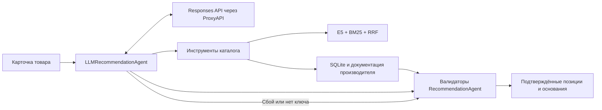

# Softline AI Search после P0

Замер от 27 ноября 2026 года на XML-снимке из 136 040 предложений. Проверены локальный подбор P0, подбор с обогащением из SQLite, агентный цикл с тестовым провайдером и реальные вызовы обеих моделей через ProxyAPI.

## Архитектура



Приложение готовит общий индекс при запуске. OpenAI SDK получает краткие карточки и типизированные условия. Сервер ограничивает шаги, инструменты, поиск, объём ответа и время. Итог проверяет правилами P0. Каталог и цены остаются локальными. Цена и наличие в карточке берутся из XML. [OpenAI Docs](https://developers.openai.com/api/docs/guides/function-calling), [ProxyAPI](https://www.proxyapi.ru/openai)

| Инструмент | Что делает |
| --- | --- |
| `get_product_details` | Возвращает короткую карточку и проверяемые характеристики. |
| `get_catalog_categories` | Находит категории по названию или по выбранному товару. |
| `search_catalog` | Выполняет гибридный поиск по подготовленному индексу. |
| `get_category_products` | Берёт кандидатов категории или поддерживаемого сценария. |
| `get_verified_specs` | Читает известную характеристику и её происхождение. |
| `search_vendor_specs` | Проверяет официальный документ по точной модели или артикулу. |
| `check_compatibility` | Запускает серверную проверку пары. |
| `compare_products` | Сравнивает только прошедших проверку кандидатов. |

Поддержаны три проверенных сценария. Перед сохранением внешнего факта сверяются домен, идентификатор модели или SKU и доказательство для конкретной характеристики. Кеш использует TTL в 30 дней. Повторные одновременные запросы на один факт объединяются. Для ручного обновления предусмотрен `--refresh`. [Логика обогащения](../../softline_search/vendor_evidence.py)

## Допродажи на реальном каталоге

| Показатель | P0, правила | P1, правила и кеш |
| --- | ---: | ---: |
| Ноутбуки с подтверждённым аксессуаром | 24 / 43 · 55,8% | 26 / 43 · 60,5% |
| ИБП APC с подтверждённой батареей | 3 / 25 | 3 / 25 |
| Офисные пакеты без уточнений | 1 / 6 | 1 / 6 |
| Офисные пакеты, Windows и одно рабочее место | 6 / 6 | 6 / 6 |
| Точность на размеченных рекомендациях | 23 / 23 | 27 / 27 |
| Доля найденных размеченных совместимых пар | 23 / 27 | 27 / 27 |
| Правильно выбранный сценарий | 32 / 32 | 32 / 32 |
| p50 после подготовки индекса, 118 вызовов | 0,14 мс | 1,11 мс |
| p95 после подготовки индекса, 118 вызовов | 5,63 мс | 6,71 мс |

Available Coverage в этих срезах совпало с Coverage. У ноутбуков в 17 из 43 карточек всё ещё отсутствуют подтверждённые габариты, у ИБП в 13 из 25 нет подтверждённого артикула батареи и ещё для девяти указанного артикула нет в фиде. Все 32 проверочных случая имеют отдельную разметку. Точность и полнота относятся к совместимым парам из этой выборки. [Пообъектный прогон](recommendations.json), [исходная разметка](../../tests/fixtures/softline_recommendations.json), [дополнительные случаи](../../tests/fixtures/softline_post_p0.json)

Для двух новых основных товаров, Lenovo IdeaPad 3 15IAU7 и Lenovo V15 G4 IRU, подтверждены габариты. Оба получили по два подходящих аксессуара HP. Получение двух фактов заняло 3,65 с, повторное чтение — 2,45 мс, оба повтора попали в кеш. [Журнал обогащения](vendor-enrichment.json), [PSREF для IdeaPad](https://psref.lenovo.com/syspool/Sys/PDF/IdeaPad/IdeaPad_3_15IAU7/IdeaPad_3_15IAU7_Spec.PDF), [PSREF для V15](https://psref.lenovo.com/syspool/Sys/PDF/Lenovo/Lenovo_V15_G4_IRU/Lenovo_V15_G4_IRU_Spec.PDF)

## Основной поиск и похожие товары

Состав и порядок каждой из 130 гибридных выдач, включая резерв, совпали с P0. HitRate@4 — 75,38%, Recall@4 — 55,31%, nDCG@4 — 57,33%. У гибрида замерены p50 140,85 мс и p95 494,33 мс при прогоне трёх методов.

Four Product Rate гибрида составил 70,77%. Четыре подтверждённых семейства есть у 92 запросов, у 38 их меньше. В трёх из этих 38 выдач доступен резерв с неподтверждёнными условиями. Constraint Satisfaction Rate по проверкам условий с учётом показанного резерва составил 498 из 508. Гибрид проверяет весь доступный индекс, а для короткой BM25-выдачи добавлен дополнительный поиск по типу и требованиям. Самостоятельную квоту для блока допродаж по имеющимся материалам подтвердить не удалось. [P0](search-p0.json), [новый прогон](search-evaluation.json)

Похожие товары выбираются по сохранённым эмбеддингам, BM25 и RRF. Условия пользователя и назначение служат фильтрами. Реальная проверка прошла на шести случаях. Например, для ThinkBook 16 G8 IRL при бюджете до 130 000 ₽ найдено четыре другие модели ThinkBook. Для Office Home & Business в категории нет другого подходящего пакета для бизнеса. Подсказки строятся по локальным названиям, префиксам, алиасам и раскладке. [Проверки похожих товаров и подсказок](search-evaluation.json)

## API, демо и надёжность

- `GET /api/recommend` сохраняет поля P0 и возвращает режим, статус выполнения, сценарии, журнал, время, основания и источники. Флаг `debug=1` даёт расширенные сведения.
- `GET /api/similar` отдаёт до четырёх проверенных по условиям альтернатив с отличиями. `GET /api/suggest` отдаёт до пяти локальных подсказок.
- Сервер обрабатывает поиск независимо от ожидания ответа агента. Автоматический тест держит запрос допродажи открытым и проверяет ответы поиска, похожих товаров и подсказок.
- Режимы `llm_agent`, `rule_based_fallback` и `cached_result` разделены. Блок «Как агент подобрал товары» показывает реально выполненные инструменты. Проверка с имитацией провайдера покрывает неправильные аргументы, неизвестные инструменты, повторы, таймауты, HTTP 429 и финальную проверку. [Тесты SDK и агента](../../tests/test_llm_agent.py), [тесты внешних источников](../../tests/test_vendor_evidence.py), [HTTP-тест](../../tests/test_demo_agent_api.py)

На реальном каталоге тестовый провайдер предложил обе модели HP для ThinkBook 16 G8 IRL. Валидатор оставил только рюкзак. Для IdeaPad 3 15IAU7 обе пары прошли проверку. Повторные запросы в тесте показали `cached_result` и повторную валидацию. Инструменты каталога в этих прогонах реальные, ответы модели заданы тестом. [Трасса тестового провайдера](agent-mock-trace.json)

Прошли 69 автоматических тестов и проверка интерфейса в Edge. Проверены клавиатурные подсказки, источники в карточках, журнал и отмена устаревшего запроса при переключении на похожие товары. На 90 последовательных HTTP-запросах к локальному режиму p50 составил 4,94 мс, p95 — 11,15 мс, максимум — 14,56 мс.

## Живой прогон GPT

Обе модели получили четыре одинаковых размеченных товара — ThinkBook 16 G8 IRL, IdeaPad 3 15IAU7 с неизвестными габаритами, APC SRT2200RMXLI-NC и Microsoft Office 2024 на один ПК. Каждую серию повторили. В начале серии каждой модели кеш фактов и кеш результатов были пусты. В итоговой серии E5 был загружен до измерений.

В первой серии режим `llm_agent` сработал у Luna в 0 из 4 холодных кейсов и у mini в 3 из 4. Обе модели пропустили поиск недостающих габаритов IdeaPad. Уточнили инструкцию, сократили рекомендуемое число кандидатов и поставили в начало подходящие по уже известным характеристикам позиции. Первый прогон сохранён для сравнения. [Первый живой прогон](gpt-live.json)

| Модель | Холодные кейсы в режиме GPT | Повторы из кеша | Найденные эталонные пары | p50 / p95, холод | p95, повтор |
| --- | ---: | ---: | ---: | ---: | ---: |
| GPT-6 Luna | 4 / 4 | 4 / 4 | 4 / 6 | 4,83 с / 8,84 с | 3,14 мс |
| GPT-5.4 mini | 4 / 4 | 4 / 4 | 6 / 6 | 4,45 с / 9,17 с | 3,77 мс |

Все выданные пары совпали с разметкой в итоговой серии. Luna предложила по одному товару в каждом кейсе, mini добавила второй аксессуар к IdeaPad и вторую подходящую лицензию к Office. Обе модели самостоятельно вызвали `search_vendor_specs` для IdeaPad. Адаптер нашёл размеры в документации Lenovo, сопоставил паспорт с артикулом и записал факт. В журнале обеих моделей есть финальная серверная проверка. Четыре кейса на модель дают сравнение прототипа на этих примерах. [Итоговый прогон с журналами](gpt-live-revised.json), [паспорт Lenovo](https://psref.lenovo.com/syspool/Sys/PDF/IdeaPad/IdeaPad_3_15IAU7/IdeaPad_3_15IAU7_Spec.PDF)

Отдельно проверен маршрут `GET /api/recommend` в демо. Для ThinkBook 16 G8 IRL он вернул совместимый рюкзак HP за 4,23 с в режиме `llm_agent`. Повтор вернул ту же рекомендацию из кеша за 0,82 мс с нулём внешних вызовов.

Два запроса габаритов выполнил прямой адаптер производителя. Отдельный живой тест встроенного `web_search` вернул официальный паспорт Lenovo. Один запрос к ProxyAPI вернул два действия инструмента при переданном `max_tool_calls=1`. Сервер учитывает накопленное число действий и блокирует следующий запрос после достижения лимита. Тест веб-поиска вынесен за рамки сравнительной серии. [Документация ProxyAPI](https://proxyapi.ru/docs/web-search)

## Экономика и оставшиеся ограничения

Расход рассчитан по фактическим входным, кешированным и выходным токенам Responses и опубликованным стандартным тарифам ProxyAPI на 27 ноября. Он отражает расчёт по телеметрии, а списания по аккаунту зависят от биллинга. Отдельный тест веб-поиска в стоимость основной серии не входит. [Тарифы двух моделей](proxyapi-rates.json), [прайс ProxyAPI](https://proxyapi.ru/models/openai)

| Вариант | Вызовов API в 4 холодных кейсах | Входные / входные из кеша / выходные | ₽ за холодный подбор | ₽ за подбор при 50% таких повторов |
| --- | ---: | ---: | ---: | ---: |
| Локальные правила и SQLite | 0 | 0 / 0 / 0 | 0 | 0 |
| GPT-6 Luna | 15 | 20 509 / 12 203 / 616 | 0,095 | 0,047 |
| GPT-5.4 mini | 17 | 21 829 / 10 368 / 522 | 0,897 | 0,449 |

Все восемь повторов в итоговой серии прошли без токенов и внешних вызовов. За 30 дней при 500 поисках в сутки и доле допродаж 10%, 25% или 50% получаем 1 500, 3 750 или 7 500 подборов.

| Модель и доля повторов | 10% допродаж | 25% допродаж | 50% допродаж |
| --- | ---: | ---: | ---: |
| Luna, 0% повторов | 142 ₽ | 355 ₽ | 709 ₽ |
| Luna, 50% повторов | 71 ₽ | 177 ₽ | 355 ₽ |
| mini, 0% повторов | 1 346 ₽ | 3 365 ₽ | 6 731 ₽ |
| mini, 50% повторов | 673 ₽ | 1 683 ₽ | 3 365 ₽ |

Расчёт для повторов предполагает попадание в локальный кеш в течение его TTL. Фактическую долю таких кликов у пользователей ещё предстоит измерить. Локальные затраты на оборудование в этой оценке отдельно не измерялись.

APC/Schneider Electric в проверенных запросах вернул HTTP 403. Непроверяемые внешние факты остаются неизвестными. Дополнительные сценарии оставлены за пределами текущей версии. При проверке XML у ноутбуков редко были однозначные сведения о USB, а у мониторов не оказалось систематически заполненных VESA и веса для проверки кронштейнов. Сравнение цен конкурентов и акции относятся к P3.

## Запуск

```powershell
.\.venv\Scripts\python.exe -m pip install -r requirements.txt
.\.venv\Scripts\python.exe -m softline_search.vendor_evidence --offer-id 460304 --offer-id 475627
.\.venv\Scripts\python.exe -m softline_search demo
.\.venv\Scripts\python.exe -B -m unittest discover -s tests -q
```

Для демо подходят запросы `Lenovo 82RK013NRK`, `ноутбук Lenovo до 130000 руб`, `APC SRT2200RMXLI-NC` и `Microsoft Office EP2-06605`. Окружение загружается при запуске процесса. [Настройка моделей и запуск оценщика](../../README.md), [локальное демо](http://127.0.0.1:8765/)

## Изменённые файлы

- Клиент Responses и цикл агента в `softline_search/llm_provider.py` и `softline_search/llm_agent.py`.
- Сбор характеристик, SQLite и повторная проверка в `softline_search/vendor_evidence.py` и `softline_search/recommendation.py`.
- Поиск, условия, подсказки и оценка в `softline_search/index.py`, `softline_search/query_catalog.py`, `softline_search/query_normalization.py`, `softline_search/suggestions.py` и `softline_search/evaluation.py`.
- HTTP и интерфейс в `softline_search/demo.py` и `softline_search/demo_web/{index.html,app.js,app.css}`.
- Запуск, настройки и оценка в `.env.example`, `.gitignore`, `requirements.txt`, `README.md` и `evaluate_post_p0.py`.
- Регрессионные тесты в `tests/test_query_search.py`, `tests/test_llm_agent.py`, `tests/test_vendor_evidence.py`, `tests/test_demo_agent_api.py` и разметка в `tests/fixtures/softline_post_p0.json`.
